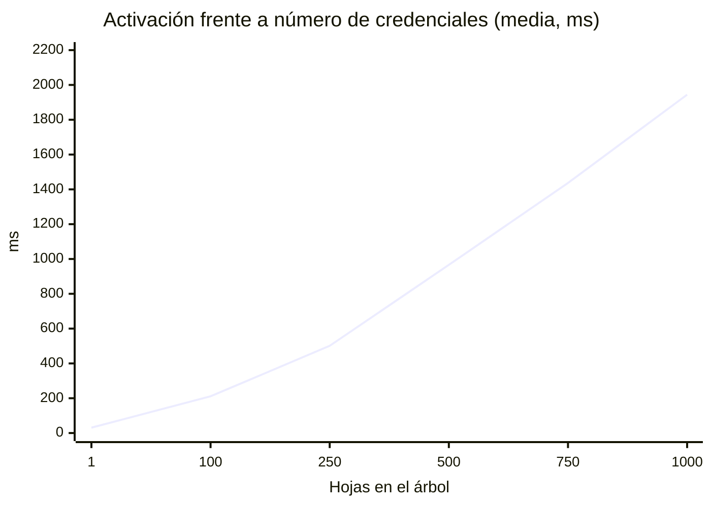

**TRU Web3**

**Informe técnico de pruebas de seguridad y estrés**

Capa de Confidencialidad Institucional (Secreto Bancario) con Pruebas de Conocimiento Cero

| Documento | Informe técnico de pruebas de seguridad y estrés |
|---|---|
| **Proyecto** | Capa de Confidencialidad Institucional con ZKP |
| **Cliente** | VCSoft S.A.S. |
| **Proveedor** | TRU Web3 |
| **Fecha** | 13 de octubre de 2026 |
| **Versión** | 1.0 |
| **Base medida** | Commit `4526fb2` más el árbol de trabajo descrito en [`evidencias/INDICE.md`](evidencias/INDICE.md) |

*Nota de actualización.* Las mediciones de este informe se hicieron sobre la base indicada. Después, al
contrastar el manual de operación con el sistema, se corrigieron cuatro defectos de operación y se
añadieron herramientas para el operador, cada cambio con su prueba. Con eso las suites pasan a
39 · 129 · 291 · 25 (484 pruebas), el índice suma 27 corridas en rojo y el catálogo de la API, 55
códigos de error. Las cifras de estrés y de gas de este informe no cambian. El estado final consta en
los registros `*_suite-completa_fase-final.log` de [`evidencias/INDICE.md`](evidencias/INDICE.md).

# 1. Resumen y alcance

Este informe reúne la evidencia de seguridad del sistema (circuito, contratos, servicio y su
relación con la cadena) y los resultados de las pruebas de estrés hechas para este entregable. Cada
afirmación remite a un fichero de prueba o a un log crudo de `docs/evidencias/`.

**Lo que se concluye, en cuatro líneas:**

1. Las garantías criptográficas y de autorización se sostienen bajo carga: 10 000 firmas válidas
   aceptadas, 2 500 inválidas de diez tipos rechazadas con el código exacto, y en 20 carreras de 200
   clientes con el mismo nonce se aceptó exactamente uno cada vez. El gas de `attestFor` no depende
   del número de inversores (desviación máxima 0,004 % entre 1 y 10 000 hojas y en la última
   posición del árbol).
2. El estrés encontró **ocho defectos reales** en el servicio, todos en el camino de escritura y de
   cadena: un 500 crudo al agotarse el *pool* de conexiones, entradas del registro de accesos
   perdidas o nunca escritas, nonces repetidos entre árboles, escrituras minadas que el servicio daba
   por fallidas (y deshacía en su base de datos), una comprobación de integridad que pasaba de 5 GB
   de memoria y un límite de tasa notificado como error JSON-RPC que no se reintentaba. Los ocho están
   corregidos, cada uno con su prueba en la suite y, donde se pudo, con una corrida de mutación que
   demuestra que la prueba lo detecta (§4.4 y §5.13).
3. El límite de capacidad del emisor no es la cadena sino el árbol: se reconstruye desde las filas
   en cada cambio a unos 2 ms por hoja. Con 1 000 credenciales una activación tarda ~1,9 s y una
   apertura ~2,1 s; el servicio lo gestiona ahora con una cola acotada y un `503` limpio, pero
   crecer más allá de unos pocos miles de credenciales exige construir el árbol por niveles
   (medido: misma raíz con ~20 veces menos cálculo).
4. En Base Sepolia el comportamiento coincide con el local: gas a ±0,1 % de Hardhat, 15
   transacciones con éxito, gasto de 0,0000094 ETH frente a un tope de 0,0005, y el estado de la red
   de pruebas reconciliado sin discrepancias.

**Fuera del alcance de este informe**, por contrato o por naturaleza: la auditoría externa del R1CS
y de los contratos, la ceremonia de *trusted setup* de producción (las claves son de una ceremonia
local, válidas para medir y probar, no para producción), pruebas de penetración de infraestructura,
el rendimiento de la aplicación del inversor en dispositivos reales y la red principal.

# 2. Entorno y método

## 2.1 Entorno

| | |
|---|---|
| Máquina | Apple M2 Max, 12 núcleos, 32 GiB · macOS 26.6.2 (Darwin 25.6.0) |
| Software | Node v22.13.1 · npm 10.9.2 · Docker 29.8.0 · Hardhat 2.29.1 · PostgreSQL 16 · Redis 7 · snarkjs 0.7 · viem 2.56.3 |
| Cadena local | Nodo Hardhat en el puerto 8565 (`npm run node`, `chainId` 31337, minado automático); para S7, Hardhat Network en proceso |
| Red de pruebas | Base Sepolia (`chainId` 84532), despliegue de `zk-contracts/deployments/baseSepolia.json` |
| Almacenes | Base de datos propia `zkapi_stress` y Redis 2 para el estrés; la suite usa `zkapi_test` y Redis 0, la red de pruebas `zkapi_testnet` y Redis 1 |
| Servicio | `zk-api` arrancado como en producción (`tsx src/server.ts`, `NODE_ENV=production`, `LOG_LEVEL=info`), un proceso, en el puerto 3071 |

La estación es de trabajo y compartida. Durante una de las corridas de S1 hubo otra carga ajena al
proyecto ocupando CPU; esa corrida se repitió con la máquina tranquila y es la que se cita (§5.1).

## 2.2 Método

Los escenarios S1–S13 son los del plan de pruebas acordado. Cada uno es un script de
`zk-api/stress/` o `zk-contracts/stress/`, fuera de `npm test`, que se lanza con un `npm run
stress:*` y deja un log crudo en `docs/evidencias/` con su fila en el índice. Los scripts:

- firman cada petición como un socio real, con la misma función de firma del servicio
  (`src/lib/signing.ts`), y hacen el lado del titular con el cliente de referencia de `zk-holder`:
  secreto propio, firma de posesión EIP-712, testigo comprobado y prueba Groth16 o PLONK real;
- arrancan el servicio como proceso aparte y, al terminar, cuentan lo que el propio servicio
  registró (respuestas por estado, errores con su código), además de lo que mide el cliente;
- contrastan siempre tres fuentes: lo que respondió la API, lo que quedó en la base de datos y lo
  que dice la cadena leída directamente del nodo (nonces, eventos de hoja, raíz);
- acaban cada prueba de escritura con una reconciliación (`POST /v1/issuer/state/rebuild`) y la de
  lectura con una contabilidad del registro de accesos.

La carga HTTP se genera con `autocannon` 8.0.0; los percentiles son exactos, calculados sobre todos
los tiempos de respuesta y no leídos de un histograma. Las latencias son de extremo a extremo en la
misma máquina, sin red de por medio, salvo en S13.

**Criterios.** Los umbrales del plan eran orientativos. Se midió primero y se fijaron así:

| Criterio | Umbral fijado | Por qué |
|---|---|---|
| Errores de servidor | 0 respuestas 5xx inexplicadas en cualquier escenario | Un 5xx es una respuesta que el integrador no puede interpretar |
| Consistencia | Reconciliación vacía tras cada escritura; integridad del registro intacta; una transacción por escritura confirmada | Es la definición de «sin pérdidas ni duplicados» |
| Registro de accesos | Toda petición procesada deja exactamente una entrada | Promesa de diseño del registro (`NOTAS-API.md` §5.6) |
| Verificación (S1) | p95 < 300 ms con c = 8 y saturación sin errores | Se midió 80 ms; el plan pedía 500 ms y es holgado |
| Lecturas (S2) | p95 < 200 ms con c = 64 | Se midió 83 ms en el peor caso |
| Escritura (S4, S10) | Sin 5xx; por encima de la capacidad, rechazo `503` limpio con `Retry-After` | La activación es lineal en las hojas; el umbral útil es el comportamiento al saturarse |
| Gas (S7, S13) | `attestFor` plano ±1 % frente al tamaño del árbol; Base Sepolia ±5 % frente a Hardhat | Los del plan; se cumplen con mucho margen |

# 3. Matriz de amenazas

Estados: **cerrado** (control implementado y probado, con mutación donde se indica), **cubierto**
(control probado sin mutación específica), **abierto** (riesgo reconocido, con su condición de
disparo en §8). NC = `zk-circuits/NOTAS-CIRCUITO.md`, NA = `zk-api/NOTAS-API.md`, EV =
`docs/evidencias/`.

## 3.1 Circuito

| Amenaza | Control | Evidencia | Estado |
|---|---|---|---|
| El emisor suplanta a un inversor ya verificado | El compromiso se construye sobre `Poseidon(secret)`, que el emisor nunca ve; activación con prueba de posesión EIP-712 (NC §1.4, NA §1.3) | `zk-circuits/test/compliance.test.mjs`; `zk-api/test/issuance-flow.test.ts` | Cerrado |
| Apertura de Merkle forjada | El circuito recompone la raíz; el atestador exige una raíz publicada y vigente | `compliance.test.mjs`; `zk-api/test/merkle.test.ts` | Cubierto |
| Desbordamiento del comparador o de rangos | `Num2Bits` sobre periodo, caducidad y país (NC §2.1) | `compliance.test.mjs` (las pruebas de rechazo comprueban el motivo) | Cerrado |
| *Aliasing* de campo en las señales públicas | `Bn254Field.contains` en el atestador y en cada adaptador | `compliance.test.mjs`; `zk-contracts/test/verifier-boundary.test.ts` | Cubierto |
| Confusión entre árboles o hoja de relleno | País ≠ 0 y acotado a 16 bits (NC §2.2) | `compliance.test.mjs` | Cerrado; etiquetas de dominio, abierto (NC §7.2) |
| Prueba copiada del *mempool* | `anchor = keccak(sujeto, cadena, atestador)`; `attestFor` lo compara con el sujeto | `zk-contracts/test/compliance-attestor.test.ts`; mutaciones `attestfor-ancla-al-remitente` y `attestfor-sin-anclaje` | Cerrado |
| Atestación acortada por reordenamiento | `AttestationWouldShorten` | Mutación `atestacion-acortable` | Cerrado |
| Atestación que sobrevive a la credencial | El circuito exige caducidad ≥ fin del periodo | `compliance.test.mjs` | Cerrado |
| Hueco de campo del verificador PLONK | El adaptador comprueba el campo él mismo | Mutación `plonk-sin-comprobar-el-campo` | Cerrado |
| Latencia de revocación | `invalidateCredentialRoot` y `revokeAttestation` | `issuance-flow.test.ts`; ciclo en Base Sepolia; S13 | **Abierto** (NC §7.1) |
| Entropía del secreto en clientes de terceros | El cliente de referencia muestrea uniforme en el campo | `zk-holder` 25/25 | **Abierto** (NC §7.3) |
| Enlazabilidad dentro del periodo; fuga por renovación tardía | Documental | NC §7.5–7.6 | **Abierto** |
| Capacidad fija 2^20 credenciales y 2^8 países | Errores limpios al agotarse | S8 | Medido; límite práctico en §7 |

## 3.2 Contratos

| Amenaza | Control | Evidencia | Estado |
|---|---|---|---|
| El módulo de cumplimiento no decide | `ZKComplianceModule` consulta la atestación; integración con la suite T-REX real | `zk-contracts/test/integration-erc3643.test.ts`; mutaciones `modulo-desenganchado`, `modulecheck-permisivo`, `identidad-no-registrada` | Cerrado |
| Esquemas de prueba no intercambiables | Frontera `IProofVerifier` con un adaptador por esquema | `verifier-boundary.test.ts` | Cerrado |
| `PROOF_SCHEME` del servicio distinto del adaptador montado | Ninguno en código | NA §7.13 | **Abierto** |
| Claves de una ceremonia local | Ninguno | NA §7.14 | **Abierto** |
| Cableado de la red de pruebas | `npm run check:base-sepolia` | EV `…_cableado-base-sepolia_completo.log` (40/40) | Cubierto |

## 3.3 Servicio

| Amenaza | Control | Evidencia | Estado |
|---|---|---|---|
| Petición forjada, repetida o fuera de ventana | HMAC por petición, nonce de un solo uso en Redis, ventana de ±300 s | `zk-api/test/partner-auth.test.ts`; **S3** | Cerrado |
| Redis caído | Falla cerrado (sin nonce no hay petición) | Revisión de código | Abierto: sin prueba específica |
| Escalada de alcances | Alcance por ruta, leído del propio middleware | `openapi.test.ts`; mutación `alcance-divergente` | Cerrado |
| Autoaprobación o liberación ajena de una divulgación | Separación de partes por solicitud y restricción en la base de datos | `disclosure-flow.test.ts`; mutaciones `autoaprobacion*`, `liberacion-por-otro-socio` | Cerrado entre socios |
| Una persona con credenciales de dos socios | `X-Partner-Actor` no firmado | NA §7.19 | **Abierto** |
| No repudio solo con HMAC | Ninguno | NA §7.6 | **Abierto** |
| Custodio único de las claves de visualización | Ninguno | NA §7.5 | **Abierto** |
| Manipulación del registro de accesos | Disparadores *append-only* y cadena HMAC con clave | `access-log.test.ts`; **S5** (504 627 entradas intactas) | Cerrado |
| Registro de accesos incompleto bajo carga o con clientes que cuelgan | Escritor único por proceso, en lotes, con reintento; las peticiones cortadas quedan como `aborted` | `write-capacity.test.ts`; **S1, S3, S4**; mutación `registro-sin-peticiones-cortadas` | **Cerrado el 13/10** (defectos D2 y D3) |
| Comprobación de integridad que agota la memoria | Recorrido por páginas | `access-log.test.ts`; **S5** | **Cerrado el 13/10** (D7) |
| Error crudo al agotarse la capacidad de escritura | Cola en memoria con límite y `503 service_busy` con `Retry-After` | `write-capacity.test.ts`; **S4**; regresión `capacidad-sin-el-arreglo` | **Cerrado el 13/10** (D1) |
| Volumen abusivo de un socio válido | Ninguno: no hay límite de peticiones | NA §7.11; **S1, S2** (capacidad medida) | **Abierto** |
| Especificación desincronizada | Rutas, alcances y errores sostenidos por prueba | `openapi.test.ts`; tres mutaciones del 04/09 | Cerrado; las respuestas no se validan (NA §7.12), abierto |

## 3.4 Cadena

| Amenaza | Control | Evidencia | Estado |
|---|---|---|---|
| Decisión tomada con una lectura rancia de `latest` | Raíz sustituida tomada del recibo; lecturas en un solo bloque no anterior a la última escritura | `chain-consistency.test.ts`; mutación `raiz-previa-de-latest` | Cerrado |
| Proveedor RPC degradado (429, latencia, recibos lentos) | Reintentos con retroceso, nunca ante un revert | `chain-rpc.test.ts`; **S12** | Cerrado |
| Límite de tasa del proveedor como error JSON-RPC | El código 429 cuenta como transitorio | `chain-rpc.test.ts`; **S13**; mutación `limite-de-tasa-json-rpc` | **Cerrado el 13/10** (D8) |
| Escritura minada que el servicio da por fallida | Espera del recibo sin comprobación de reemplazo; reenvío reconocido por su hash | `chain-rpc.test.ts`; **S12**; mutaciones `recibo-rezagado-como-fallo` y `reenvio-minado-como-fallo` | **Cerrado el 13/10** (D5, D6) |
| Nonce repetido entre escrituras de un mismo proceso | Envíos de uno en uno | `chain-rpc.test.ts`; **S10**; mutación `envios-sin-turno` | **Cerrado el 13/10** (D4) |
| Más de una instancia firmando con la misma clave | Ninguno | NA §7.16; **S11** | **Abierto** |
| Las emisiones se serializan | Cola por árbol y *advisory lock* | **S4, S10** | Medido; límite en §7 |
| Rango de `eth_getLogs` limitado por el proveedor | Ventanas configurables que se parten a la mitad si el nodo las rechaza | `chain-rpc.test.ts`; **S9** | Cubierto; el coste depende del proveedor que se elija (§7) |
| Divergencia entre base de datos y cadena | La reconciliación la nombra, no la repara | Todas las pruebas de escritura | Por diseño |

# 4. Pruebas de seguridad

## 4.1 Suites tras los cambios de este entregable

| Proyecto | Comando | Resultado | Log |
|---|---|---|---|
| `zk-circuits` | `npm test` | **39/39** | EV `2026-10-13_zk-circuits_compliance_tras-estres.log` |
| `zk-contracts` | `npx hardhat test` | **120/120**, incluida la integración con la suite T-REX real | EV `2026-10-13_zk-contracts_suite-completa_tras-estres.log` |
| `zk-api` | `npm run typecheck && npm test` | `tsc` limpio y **259/259** sobre PostgreSQL y Redis reales | EV `2026-10-13_zk-api_suite-completa_tras-estres.log` |
| `zk-holder` | `npm run typecheck && npm test` | `tsc` limpio y **25/25** | EV `2026-10-13_zk-holder_pruebas-unitarias_tras-estres.log` |

Son **443 pruebas**. La suite del servicio pasó de 244 a 259 con las quince pruebas que fijan los
defectos que encontró el estrés (§5.13). Circuito y contratos no cambiaron; se volvieron a correr
para dejar constancia.

## 4.2 Circuito

La suite compila el circuito y prueba los cuatro predicados por separado, los rangos, el
*aliasing* de campo, la separación entre los dos árboles, el anclaje y el nulificador. Las pruebas
de rechazo localizan en el código fuente la restricción que debe saltar y exigen que el error la
nombre, de modo que no pueden pasar por el motivo equivocado. El camino feliz se comprueba además
contra el R1CS con `wtns.check`. Detalle en NC §8.

## 4.3 Contratos y frontera del verificador

La integración despliega la suite T-REX real del estándar ERC-3643 y recorre el ciclo completo con
la plataforma presentando la prueba (`attestFor`). La frontera del verificador recorre la
atestación completa dos veces sobre el mismo testigo, una por esquema, con el mismo nulificador, el
mismo periodo y el mismo evento. Gas en §6.

## 4.4 Mutaciones

Una suite en verde sólo dice que sus aserciones se cumplen. Las corridas de mutación rompen el
sistema a propósito y exigen que la suite lo detecte; el índice registra **20**, todas en rojo:

| Fecha | Proyecto | Qué se rompe | Resultado | Log (EV) |
|---|---|---|---|---|
| 13/10 | `zk-api` | La prueba nueva de la ráfaga, contra el código anterior al arreglo de capacidad | 1 en rojo (`P2024`) | `…_regresion-capacidad-sin-el-arreglo.log` |
| 13/10 | `zk-api` | El registro de accesos deja de escuchar el cierre de la conexión | 1 en rojo | `…_mutacion-registro-sin-peticiones-cortadas.log` |
| 13/10 | `zk-api` | Los envíos a la cadena dejan de ir de uno en uno | 2 en rojo | `…_mutacion-envios-sin-turno.log` |
| 13/10 | `zk-api` | La espera del recibo vuelve a comprobar reemplazos | 1 en rojo | `…_mutacion-recibo-rezagado-como-fallo.log` |
| 13/10 | `zk-api` | El reenvío «nonce too low» deja de reconocerse por su hash | 1 en rojo | `…_mutacion-reenvio-minado-como-fallo.log` |
| 13/10 | `zk-api` | El 429 JSON-RPC deja de ser transitorio | 1 en rojo | `…_mutacion-limite-de-tasa-json-rpc.log` |
| 13/10 | `zk-api` | Se quita la comprobación de que quien decide no es quien pidió | 2 en rojo | `…_mutacion-autoaprobacion.log` |
| 13/10 | `zk-api` | La misma, y además la restricción de la base de datos | 3 en rojo | `…_mutacion-autoaprobacion-sin-restriccion.log` |
| 13/10 | `zk-api` | Otro socio puede liberar una divulgación ajena | 2 en rojo | `…_mutacion-liberacion-por-otro-socio.log` |
| 13/10 | `zk-api` | La revocación toma la raíz previa de una lectura de `latest` | 2 en rojo | `…_mutacion-raiz-previa-de-latest.log` |
| 13/10 | `zk-contracts` | `attestFor` ancla al remitente en vez de al sujeto | 17 en rojo | `…_mutacion-attestfor-ancla-al-remitente.log` |
| 13/10 | `zk-contracts` | Sin `AttestationWouldShorten` | 2 en rojo | `…_mutacion-atestacion-acortable.log` |
| 13/10 | `zk-contracts` | `attestFor` sin comprobar el anclaje | 4 en rojo | `…_mutacion-attestfor-sin-anclaje.log` |
| 04/09 | `zk-contracts` | El adaptador PLONK no comprueba el campo | 1 en rojo | `…_mutacion-plonk-sin-comprobar-el-campo.log` |
| 04/09 | `zk-api` | Ruta servida y no documentada | 1 en rojo | `…_mutacion-ruta-sin-documentar.log` |
| 04/09 | `zk-api` | Código de error fuera del catálogo | 2 en rojo | `…_mutacion-codigo-de-error-sin-catalogar.log` |
| 04/09 | `zk-api` | Alcance de la especificación distinto del de la ruta | 1 en rojo | `…_mutacion-alcance-divergente.log` |
| 03/09 | `zk-contracts` | Módulo ZK desenganchado de la *compliance* | 10 en rojo | `…_mutacion-modulo-desenganchado.log` |
| 03/09 | `zk-contracts` | `moduleCheck` que siempre aprueba | 8 en rojo | `…_mutacion-modulecheck-permisivo.log` |
| 03/09 | `zk-contracts` | Titular fuera del `IdentityRegistry` (discriminador) | 4 en rojo | `…_mutacion-identidad-no-registrada.log` |

El circuito se validó además con dos mutaciones anteriores a la convención de log por corrida:
con una prueba de rechazo que espera el motivo equivocado, la suite falla; y con el cuadrado del
anclaje retirado del circuito, fallan las dos pruebas que miran al R1CS, mientras la que compara
testigos sigue pasando, que es la razón de que el anclaje se compruebe de tres formas
(`zk-circuits/test/compliance.test.mjs`; NC §3.1).

## 4.5 Cadena y RPC degradado

`zk-api/test/chain-rpc.test.ts` pone los clientes reales de viem delante de un nodo JSON-RPC
guionizado: 429 y 5xx reintentados con retroceso, revert nunca reintentado, recibos lentos,
confirmaciones, `getLogs` troceado, y desde este entregable los seis comportamientos que encontró
el estrés (§5.13). S12 hace lo mismo contra el nodo real, con un proxy que inyecta los fallos, y
S13 contra la red pública Base Sepolia.

# 5. Estrés y rendimiento

## 5.1 S1 · Verificación de pruebas (`POST /v1/verifications`)

Prueba real del titular de la hoja 0, generada con el cliente de referencia; 60 s por nivel de
concurrencia. Cada petición verifica la prueba con snarkjs, hace seis lecturas de cadena en un único
bloque, guarda la verificación y anexa al registro. Cifras de la corrida tras los arreglos, con la
máquina sin carga ajena:

| Esquema | c | rps | p50 | p95 | p99 | 5xx | RSS del servicio |
|---|---|---|---|---|---|---|---|
| Groth16 | 1 | 66,8 | 14,4 ms | 17,5 ms | 27,6 ms | 0 | 540 MiB |
| Groth16 | 8 | 111,2 | 71,1 ms | 80,4 ms | 94,9 ms | 0 | 681 MiB |
| Groth16 | 32 | 123,1 | 257,0 ms | 282,4 ms | 334,8 ms | 0 | 743 MiB |
| PLONK | 8 | 80,2 | 98,2 ms | 124,8 ms | 148,8 ms | 0 | 577 MiB |

La verificación está ligada a la CPU de un proceso: a partir de c ≈ 8 el rendimiento se aplana en
~110–123 rps y la latencia crece en proporción a la cola (c × 4 → p50 × 3,6), sin errores. La
primera corrida, antes de los arreglos, dio cifras equivalentes (107,8 rps y p95 84,5 ms con c = 8)
y es la que destapó el defecto D3: 22 216 verificaciones guardadas frente a 22 176 entradas del
registro. Tras el arreglo, 22 929 = 22 929.

EV: `2026-10-13_zk-api_estres-s1-verificaciones.log`, `…_tras-el-arreglo.log`.

## 5.2 S2 · Lecturas del banco

Recorriendo en rueda los 1 090 titulares activos, 60 s por nivel:

| Ruta | c | rps | p50 | p95 | p99 |
|---|---|---|---|---|---|
| `GET /v1/compliance/assets/:asset/subjects/:subject` | 1 | 368 | 2,5 ms | 3,5 ms | 5,6 ms |
| | 16 | 1 075 | 13,8 ms | 19,5 ms | 33,1 ms |
| | 64 | 1 030 | 56,9 ms | 82,6 ms | 169,0 ms |
| `GET /v1/credentials/:commitment` | 1 | 315 | 2,5 ms | 5,4 ms | 14,9 ms |
| | 16 | 1 750 | 8,4 ms | 11,9 ms | 21,8 ms |
| | 64 | 2 033 | 29,5 ms | 44,8 ms | 70,8 ms |
| `GET /v1/credentials/:commitment/opening` | 1 | 0,5 | 2 093 ms | 2 464 ms | No medido |
| | 4 | 0,4 | 8 503 ms | 13 351 ms | No medido |

0 respuestas no 2xx en 394 000 peticiones. Las aperturas son el punto débil: cada una reconstruye
el árbol completo (~2,1 s con 1 090 hojas) y, mientras lo hace, el proceso no atiende nada más.

EV: `2026-10-13_zk-api_estres-s2-lecturas.log`.

## 5.3 S3 · Firmas HMAC

| Prueba | Resultado |
|---|---|
| 10 000 peticiones válidas, c = 16 | 10 000 aceptadas · 2 653 rps · p95 9,3 ms |
| 2 500 inválidas de diez tipos (firma inventada, consulta cambiada tras firmar, otro secreto, ventana vencida y futura, marca no numérica, nonce corto, socio desconocido, sin cabeceras, alcance ajeno) | 2 500 con el estado y el código exactos (100 %) |
| 250 peticiones reenviadas tal cual | 250 originales aceptadas, 250 repeticiones con `replayed_nonce` |
| 20 carreras de 200 clientes con el mismo nonce (la mitad con la misma petición, la mitad con 50 rutas distintas) | 20/20 con **exactamente una** aceptada y 199 `replayed_nonce` |
| Registro de accesos | 17 000 entradas para 17 000 peticiones, autenticadas o no |

La primera versión del script usaba ±301 s para los casos de ventana y una petición de «+301 s»
llegó cuando el reloj del servidor ya había avanzado un segundo: estaba dentro de la ventana y se
aceptó, correctamente. Se corrigió el script (±310 s) y se repitió; el log citado es esa corrida.

EV: `2026-10-13_zk-api_estres-s3-firmas-hmac.log`.

## 5.4 S4 · Emisión y activación

**En serie hasta 1 000 hojas.** El alta (paso 1) cuesta ~7 ms y no depende de las hojas. La
activación crece linealmente: ajuste de 19,9 ms + 1,93 ms por hoja (R² 0,979), casi todo la
reconstrucción del árbol desde las filas (medida aparte: 2,03 s con 1 048 hojas). La reconciliación
salió vacía con 1, 100 y 1 000 hojas.

| Hojas | 1 | 100 | 250 | 500 | 750 | 1 000 |
|---|---|---|---|---|---|---|
| Activación media | 31 ms | 211 ms | 501 ms | 966 ms | 1 437 ms | 1 944 ms |



**Lotes concurrentes.** Con 10 a la vez, todo correcto (19,3 s el lote, ~1,9 s por activación,
porque se serializan). **Con 50 a la vez, 12 respuestas 500 crudas y 12 entradas del registro
perdidas** (defectos D1 y D2). Tras el arreglo: lotes de 10 y 16 completos; con 50, las 16 que caben
en la cola se activan y las 34 restantes reciben al momento `503 service_busy` con `Retry-After: 5`,
sin tocar nada. Ningún 5xx distinto, ningún error en el registro del servicio, reconciliación vacía.

EV: `2026-10-13_zk-api_estres-s4-emision-y-activacion.log`, `…_tras-el-arreglo.log`.

## 5.5 S5 · Integridad del registro de accesos

Tras S1–S4, S10 y S12 el registro tenía **504 627 entradas**: secuencia sin huecos y cadena intacta.
La comprobación tardaba 7,6 s y **llevaba el servicio a 5 129 MiB** porque cargaba el registro
entero (defecto D7). Recorriéndolo por páginas: 6,6 s (13 µs por entrada) y 661 MiB.

EV: `2026-10-13_zk-api_estres-s5-integridad-del-registro.log`, `…_tras-el-arreglo.log`.

## 5.6 S6 · Generación de pruebas

`RUNS=30` en serie y rondas de 4 y 8 pruebas a la vez en un proceso:

| Esquema | En serie: mediana (p95) | Verificar en JS | 4 a la vez | 8 a la vez | RSS máximo |
|---|---|---|---|---|---|
| Groth16 | 673 ms (723 ms) | 11,0 ms | 1,82 pruebas/s | 1,67 pruebas/s | 1 550 MiB |
| PLONK | 12 166 ms (12 824 ms) | 13,6 ms | 0,08 pruebas/s | 0,08 pruebas/s | 2 275 MiB |

snarkjs ya reparte cada prueba entre todos los núcleos, así que lanzar varias a la vez no multiplica
el rendimiento: una máquina de esta clase da ~1,5–1,8 pruebas Groth16 por segundo. Para quien prueba,
que es el inversor una vez por activo y periodo, Groth16 es del orden de un segundo; PLONK, del orden
de diez y con más memoria. Es otro argumento para Groth16, además del gas (§6).

EV: `2026-10-13_zk-api_estres-s6-generacion-de-pruebas.log`.

## 5.7 S7 · Gas frente al tamaño del árbol y del lote

Ver §6. EV: `2026-10-13_zk-contracts_estres-s7-gas.log`.

## 5.8 S8 · Capacidad de los árboles

| Medida | Resultado |
|---|---|
| `SparseMerkleTree.from` (como lo construye el servicio) | 1 000 hojas 2,0 s · 10 000 hojas 20,4 s · 100 000 hojas 198,5 s · ~100 µs por llamada a Poseidon, 20 llamadas por hoja |
| Construcción por niveles (medida, no desplegada) | 1 000 hojas 95 ms · 100 000 hojas 9,3 s · árbol lleno, 1 048 576 hojas, 99,8 s · **misma raíz** · ~20 veces menos llamadas |
| Prueba con la hoja en el índice 2^20 − 1 de un árbol lleno | Apertura válida, prueba Groth16 en 1,08 s que verifica; también con el país en la última posición (255) del árbol de jurisdicciones |
| Activación con el árbol lleno | `409 credential_tree_full` (capacidad 1 048 576); la credencial queda pendiente, sin compromiso ni posición, y se puede cancelar |
| Jurisdicciones | 256 países aceptados (`leafCount` 256, reconstrucción conforme); el 257.º, `400 validation_failed` |

EV: `2026-10-13_zk-api_estres-s8-capacidad.log`.

## 5.9 S9 · Reconstrucción desde los eventos

Registro propio con 100 publicaciones de 100 cambios separadas por 99 bloques vacíos (~10 000
bloques), con retiradas intercaladas para que el orden importe. Además de las ventanas normales, se
simula un nodo que solo admite 10 bloques por llamada:

| Hojas | Ventana | `eth_getLogs` | Tiempo | Raíz |
|---|---|---|---|---|
| 995 | 200 / 2 000 / 10 000 | 6 / 1 / 1 | ~1,9 s | idéntica |
| 995 | nodo simulado de 10 bloques, ventana 2 000 | 151 | 2,1 s | idéntica |
| 9 950 | 200 / 2 000 / 10 000 | 51 / 6 / 2 | ~19,4 s | idéntica |
| 9 950 | nodo simulado de 10 bloques, ventana 2 000 | 1 437 | 20,2 s | idéntica |
| 9 950 | nodo simulado de 10 bloques, ventana 10 | 1 001 | 19,7 s | idéntica |

La ventana que el nodo rechaza se parte sola hasta caber (de 2 000 a 7 bloques). En local la
red no cuesta y el tiempo es la reproducción del árbol (~2 ms por hoja); contra una red real,
cada `eth_getLogs` cuesta cientos de milisegundos y es el número de llamadas lo que manda (§5.12).

EV: `2026-10-13_zk-api_estres-s9-reconstruccion.log`.

## 5.10 S10 · Escrituras concurrentes desde un proceso

Con la cola ampliada (`ISSUER_WRITE_QUEUE_LIMIT=200`) para que todas las escrituras entren a la vez:

| Ronda | Antes del arreglo | Después |
|---|---|---|
| 10 activaciones + 10 revocaciones con cierre de ventana | 20/20; 30 transacciones (las esperadas); 0 rupturas de la cadena de raíces | Igual |
| 50 + 50 | 100/100; 150 transacciones; 0 rupturas; 208 s el lote | Igual |
| 20 cambios de jurisdicción en activos distintos + 10 activaciones | **2 de 30**; 28 fallan por nonce (defecto D4) | **30/30**; 30 transacciones; 0 respuestas que mencionen el nonce |

Cada publicación nombra como predecesora la raíz anterior en orden de bloque, sin una sola ruptura
en 1 340 publicaciones, y la reconciliación sale vacía tras cada ronda.

EV: `2026-10-13_zk-api_estres-s10-escrituras-concurrentes.log`, `…_tras-el-arreglo.log`.

## 5.11 S11 · Dos instancias con la misma clave (informativa)

Dos procesos sobre la misma base de datos y la misma clave: 10 activaciones en cada uno y 10 cambios
de jurisdicción en el segundo, a la vez. En esta corrida, 30/30 con éxito. No demuestra que sea
seguro: con minado automático la ventana entre leer el nonce y enviar es de microsegundos, y las
activaciones de los dos procesos se ordenan por el *advisory lock* compartido; los cambios de
jurisdicción de un proceso frente a las activaciones del otro sí pueden tomar el mismo nonce, y en
una red con *mempool* la ventana es mayor. El arreglo D4 ordena los envíos dentro de un proceso,
no entre procesos. El riesgo sigue abierto (§8).

EV: `2026-10-13_zk-api_estres-s11-dos-instancias-misma-clave.log`.

## 5.12 S12 y S13 · Cadena degradada y red real

**S12.** Proxy entre el servicio y el nodo con 20 % de respuestas 429, 20–150 ms de latencia,
recibos ocultos durante 3 s y un 10 % de respuestas de envío perdidas tras entregar la transacción
al nodo; 50 activaciones con concurrencia 5.

| | Antes de los arreglos | Después |
|---|---|---|
| Respuestas | **50 × 424 `chain_call_failed`** | 50 × 201 |
| Transacciones minadas / eventos de hoja / activas en BD | **50 / 50 / 0** | 50 / 50 / 50 |
| Fallos inyectados | 203 × 429, 144 recibos ocultos, 2 envíos perdidos | 358 × 429, 216 recibos ocultos, 6 envíos perdidos, todos recuperados |
| Reconciliación | `missingFromDatabase` = 1 (las demás, enmascaradas por la publicación siguiente en la misma posición) | Vacía |
| Revert inyectado | 1 estimación, 0 envíos, credencial intacta | Igual |

Antes de los arreglos el servicio daba por fallidas escrituras que la cadena había aceptado y
deshacía la activación en su base de datos (defectos D5 y D6). Una corrida intermedia dejó una sola
de 50 en ese estado: la consulta que decide si el nodo ya tiene la transacción recibió a su vez un
429 y no se reintentaba; se corrigió y tiene su prueba.

**S13.** Contra Base Sepolia con el servicio real (`.env.testnet`, 2 confirmaciones), presupuesto
de 0,0005 ETH comprobado antes de cada transacción:

| Paso | Resultado |
|---|---|
| 20 lecturas de cumplimiento / de credencial; 10 verificaciones | p50 306 / 206 / 332 ms; p95 389 / 218 / 773 ms |
| 3 activaciones de titulares nuevos | 4,5–5,6 s cada una (dos confirmaciones) |
| 3 pruebas locales y `attestFor` presentado por Y | prueba ~2,1 s; el banco la comprueba como válida antes de presentar |
| Limpieza: 3 `revokeAttestation` y 3 revocaciones con cierre de ventana | ~11 s cada revocación (publicación e invalidación) |
| Transacciones | 15, todas con éxito, todas de Y; X no firmó nada |
| Gasto | **0,0000094 ETH** (Y), coincidente con la suma de comisiones de los recibos |
| Reconstrucción final | **424**: un límite de tasa notificado como error JSON-RPC 429 no se reintentaba (defecto D8) |
| Reconciliación tras el arreglo | Credenciales: 10 eventos, 2 hojas vivas, `matchesChain`, 0 discrepancias, 64 s · jurisdicciones: `matchesChain`, 81 s · registro intacto |

Las transacciones de S13, con su enlace a Basescan, están en el log. Los tres titulares nuevos quedan
revocados y sin atestación: el estado de la red de pruebas es el del ciclo anterior más tres
credenciales activadas y revocadas, y el árbol vuelve a la misma raíz que tenía.

EV: `2026-10-13_zk-api_estres-s12-rpc-degradado.log`, `…_tras-el-arreglo.log`,
`2026-10-13_zk-api_estres-s13-base-sepolia.log`, `…_reconciliacion.log`.

## 5.13 Defectos encontrados y corregidos

| # | Prueba | Defecto | Consecuencia | Arreglo | Prueba que lo fija |
|---|---|---|---|---|---|
| D1 | S4 | Cada cambio de árbol en espera del *advisory lock* retenía una conexión del *pool* | Con 50 activaciones, `P2024` y **500 crudo** en 12 peticiones; cualquier otra consulta del servicio podía caer | Cola en memoria por árbol: sólo el cambio en curso tiene conexión; pasado `ISSUER_WRITE_QUEUE_LIMIT` (16), `503 service_busy` con `Retry-After`; `P2024`/`P2028` salen como `503` | `write-capacity.test.ts` (ráfaga, límite, saturación); falla sobre el código anterior |
| D2 | S4 | Cada petición anexaba al registro en su propia transacción a la espera del *lock* | **Entradas del registro perdidas** al agotarse el *pool* | Un escritor por proceso que anexa en lotes encadenados y reintenta | `write-capacity.test.ts` (70 entradas para 70 peticiones durante la ráfaga) |
| D3 | S1 | El registro se escribía al terminar la respuesta | Una petición cuyo cliente colgaba **se procesaba y no quedaba registrada** | Se registra también al cerrarse la conexión, como `aborted` con estado 499 | `write-capacity.test.ts`; mutación |
| D4 | S10 | `consume` del gestor de nonces no estaba serializado y los árboles distintos van bajo bloqueos distintos | **Nonces repetidos**: 28 de 30 escrituras fallidas | El nonce se toma y la transacción se entrega de uno en uno | `chain-rpc.test.ts` (dos pruebas); mutación |
| D5 | S12 | La espera del recibo de viem comprueba reemplazos y toma un recibo rezagado por fallo | **Escritura minada dada por fallida**; la base de datos deshacía la activación y la hoja quedaba en cadena sin registro | Espera sin comprobación de reemplazo (nadie más firma con la clave) | `chain-rpc.test.ts`; mutación |
| D6 | S12 | El reenvío tras una respuesta perdida recibe «nonce too low» si la transacción ya se minó | Igual que D5 | Si el nodo tiene la transacción con ese hash, es la enviada (consulta con reintentos) | `chain-rpc.test.ts` (tres pruebas); mutación |
| D7 | S5 | La comprobación de integridad cargaba el registro entero | **5,1 GB** con medio millón de entradas; con un orden de magnitud más, el proceso cae | Recorrido por páginas, arrastrando hash y secuencia | `access-log.test.ts` (dos pruebas) |
| D8 | S13 | Un límite de tasa puede llegar como error JSON-RPC 429, no como HTTP 429, y no se trataba como transitorio | **Reconstrucción fallida** ante una red que limita la tasa | El código 429 y su texto cuentan como transitorios | `chain-rpc.test.ts`; mutación |

Ninguno exigió rediseñar: son cambios acotados en `issuer.service.ts`, `registry.service.ts`,
`chain.ts`, `access-log.ts`, `access-log.service.ts` y el manejador de errores, con un código nuevo
en el catálogo (`service_busy`, que pasa a 54) y una variable de entorno nueva
(`ISSUER_WRITE_QUEUE_LIMIT`). Lo que sí apunta a un cambio de diseño, el coste del árbol, se deja
como recomendación (§9).

# 6. Gas

Medido en Hardhat (S7, prueba Groth16 real en cada atestación) y en Base Sepolia (S13 y el ciclo
completo del 13/10):

| Operación | Hardhat | Base Sepolia | Diferencia | Quién paga |
|---|---|---|---|---|
| `attestFor` (Groth16) | 344 957 – 344 981 | 345 217 – 345 229 | +0,07 % | La plataforma |
| `attestFor` (PLONK) | 399 584 | No desplegado | No aplica | La plataforma |
| `publishCredentialRoot`, 1 cambio | 59 660 | 59 660 – 59 672 (57 660 en una revocación) | 0,00 % a +0,02 % (−3,35 %) | El emisor |
| `invalidateCredentialRoot` | 28 005 | 28 005 | 0,00 % | El emisor |
| `revokeAttestation` | 29 447 | 29 476 | +0,10 % | La plataforma |
| `publishCountryRoot`, 1 país | 55 462 | No medido | No aplica | El emisor |
| `publishCountryRoot`, 256 países | 945 157 | No medido | No aplica | El emisor |

Las diferencias de decenas de gas son bytes nulos de más o de menos en el *calldata* de cada
prueba. La revocación que costó 2 000 gas menos (−3,35 %) es otro estado de almacenamiento, no otro
código: la tercera revocación devuelve el árbol a una raíz que ya había estado publicada, y borrar
su marca de sustitución tiene reembolso. Lo mismo ocurrió con la revocación del ciclo completo.

**`attestFor` no depende del número de inversores.** Con árboles de 1, 100, 1 000 y 10 000 hojas y
con el titular en la última posición posible (2^20 − 1), la desviación máxima respecto de la media
es del **0,004 %**: el atestador nunca recorre el árbol, sólo comprueba que la raíz está publicada.

**La publicación es lineal en los cambios:** 55 289 gas fijos más 3 388,5 por cambio (R² 1,000000,
de 1 a 2 000 cambios). Agrupar cambios abarata mucho: 100 activaciones publicadas juntas cuestan
394 136 gas frente a 5 966 000 publicadas una a una (15 veces menos). Con el límite de bloque de
Hardhat (60 M) caben ~17 700 cambios en una transacción; en otra red manda su propio límite.

Al precio observado en Base Sepolia (0,006 gwei más la tarifa L1), una activación cuesta ~0,00000036
ETH y una atestación ~0,0000021 ETH. Detalle por transacción en el log de S13 y en
`evidencias/2026-10-13_testnet-base-sepolia_ciclo-completo.md`.

# 7. Capacidad y límites

Por proceso del servicio, en la máquina de §2.1:

| Recurso | Capacidad medida | Qué la limita |
|---|---|---|
| Verificación de pruebas | ~110–123 rps (Groth16), ~80 rps (PLONK) | CPU de la verificación; escala con procesos |
| Lecturas de cumplimiento y de credencial | ~1 000–2 000 rps, p95 < 85 ms | Base de datos y nodo |
| Activaciones | Una a la vez por árbol; ~1,9 s cada una con 1 000 credenciales, ~20 s estimados con 10 000 | Reconstrucción del árbol (2 ms por hoja); no escala con procesos |
| Cola de cambios | 16 en espera por árbol (configurable); el resto, `503` | `ISSUER_WRITE_QUEUE_LIMIT` |
| Aperturas | ~0,5 por segundo con 1 000 credenciales, y bloquean el proceso mientras duran | Reconstrucción del árbol |
| Árbol de credenciales | 1 048 576 posiciones (las posiciones no se reutilizan); límite práctico de unos pocos miles mientras el árbol se reconstruya hoja a hoja | Profundidad del circuito; coste de construcción |
| Árbol de jurisdicciones | 256 países por activo | Profundidad del circuito |
| Comprobación de integridad | 13 µs por entrada (6,6 s por cada medio millón) | Recorrido completo de la cadena |
| Reconstrucción desde la cadena | ~2 s por cada 1 000 hojas, más el coste de `eth_getLogs` | Proveedor RPC |
| Generación de pruebas (lado del inversor) | Groth16 ~0,7 s, PLONK ~12 s en esta máquina | Dispositivo del inversor |

**El coste de una reconstrucción contra una red real** depende del proveedor RPC que se elija: del
rango de bloques que admita en cada `eth_getLogs` y de su límite de tasa. El servicio lee en ventanas
de `CHAIN_LOG_BLOCK_RANGE` bloques, parte las que el nodo rechaza y reintenta ante límites de tasa,
así que la reconstrucción termina igual; lo que cambia es el número de llamadas, que crece con la
historia de la cadena (Base produce ~43 200 bloques al día) y baja cuanto mayor es el rango admitido.

# 8. Riesgos abiertos y condiciones de disparo

| Riesgo | Referencia | Condición de disparo y acción |
|---|---|---|
| Sin límite de peticiones | NA §7.11; S1, S2 | Antes de exponer el servicio fuera de una red controlada: límite por socio y por ruta en el servicio o en la pasarela |
| `PROOF_SCHEME` y adaptador montado pueden divergir | NA §7.13 | Antes de producción: leer `attestor.verifier().scheme()` al arrancar y negarse a servir si no coincide |
| Ceremonia local de las claves | NA §7.14 | Antes de producción: ceremonia de *trusted setup* con participantes independientes |
| Sin auditoría externa del circuito ni de los contratos | NC §7.8, NA §7.15 | Antes de producción |
| Coste del árbol (2 ms por hoja, bloquea el proceso) | NA §7.20; S4, S2, S8 | Pasadas unas pocas miles de credenciales o con aperturas frecuentes: construcción por niveles y árbol en memoria |
| Emisión serializada | NA §7.8; S4, S10 | Con picos de alta superiores a ~1 activación cada 2 s: publicación por lotes |
| Más de una instancia firmando | NA §7.16; S11 | Si se despliega más de una instancia: un único trabajador de escritura o una cola |
| Rango de consultas de eventos del proveedor RPC | S9; §7 | Al elegir el proveedor: comprobar el rango que admite `eth_getLogs` y ajustar `CHAIN_LOG_BLOCK_RANGE` |
| Latencia de revocación hasta `rootValidityWindow + 2 × epochLength` | NC §7.1 | Ya mitigada con el cierre de ventana y `revokeAttestation`; vigilar si cambia la longitud de época |
| Entropía del secreto en aplicaciones de terceros | NC §7.3 | Si otra aplicación implementa el lado del inversor: exigir el muestreo del cliente de referencia |
| Pérdida de la billetera o de la copia del secreto | NA §7.1–7.2 | La copia de seguridad cifrada del cliente es requisito de aceptación |
| Custodio único de las claves de visualización | NA §7.5 | Si el modelo incluye a un operador con acceso al gestor de secretos: esquema de umbral |
| No repudio sólo con HMAC | NA §7.6 | Si una solicitud de divulgación debe sostenerse ante terceros: firma asimétrica del socio |
| Una persona con dos socios | NA §7.19 | Si el modelo incluye a un funcionario con acceso a dos socios: actor firmado y validado contra un directorio |
| Redis caído sin prueba específica | §3.3 | Antes de producción: prueba de caída de Redis (debe fallar cerrado) |
| Respuestas no validadas contra la especificación | NA §7.12 | En cuanto un integrador genere cliente desde `openapi.yaml` |
| Reorganizaciones más profundas que `CHAIN_CONFIRMATIONS` | NA §7.18 | La reconciliación lo detecta; revisar las confirmaciones en otra red |
| Enlazabilidad dentro del periodo y fuga por renovación tardía | NC §7.5–7.6 | Documental: limita lo que se puede prometer sobre privacidad |

# 9. Conclusiones y recomendaciones

**Conclusiones.** Las garantías del sistema (quién puede probar, qué se puede presentar en cadena,
quién puede pedir y aprobar una divulgación, qué queda registrado) se sostienen bajo carga y bajo
una cadena degradada. Lo que el estrés encontró estaba en el camino de escritura del servicio y en
su relación con la cadena, y era del tipo que sólo aparece con concurrencia y fallos reales: pérdida
de registros de auditoría, escrituras minadas que el servicio no reconocía, nonces repetidos y
errores crudos al saturarse. Los ocho defectos están corregidos y fijados por pruebas; la suite del
servicio pasa de 244 a 259 y el índice de evidencias suma seis corridas de mutación.

**Recomendaciones**, por orden de prioridad:

1. **Límite de peticiones** por socio y por ruta antes de exponer el servicio. La cola de escritura
   protege los cambios de árbol; nada protege las verificaciones (CPU) ni las aperturas.
2. **Comprobar al arrancar el esquema montado en el atestador** (`attestor.verifier().scheme()`)
   contra `PROOF_SCHEME`, y negarse a servir si no coinciden.
3. **Construir el árbol por niveles y mantenerlo en memoria** entre cambios. Es la mejora de mayor
   efecto: medida en S8, la misma raíz con ~20 veces menos cálculo (100 s para el árbol lleno frente
   a ~35 min estimados hoja a hoja). Baja la activación y la apertura de segundos a decenas de
   milisegundos con miles de credenciales.
4. **Publicación por lotes** cuando el volumen de altas lo pida. S4 la justifica para picos: hoy el
   emisor admite del orden de una activación cada 2 s con 1 000 credenciales, y la publicación
   agrupada cuesta 15 veces menos gas por cambio. Exige decidir qué se le dice al inversor entre
   la activación y la publicación, por eso va detrás de la recomendación 3, que por sí sola resuelve
   la latencia.
5. **Auditoría externa y ceremonia de claves antes de producción**, para el circuito, los contratos
   y las claves de los dos esquemas.

# 10. Anexos

## 10.1 Cómo reproducir

```bash
docker start zk-api-postgres zk-api-redis
cd zk-contracts && npm run node                     # otra terminal; puerto 8565

cd zk-api
npm run stress:setup                                # contratos nuevos, .env.stress, zkapi_stress vacía, socios
npm run stress:s4                                   # deja 1 000 credenciales para el resto
npm run stress:s1 && npm run stress:s2 && npm run stress:s3
npm run stress:s10 && npm run stress:s12 && npm run stress:s11
npm run stress:s5 && npm run stress:s9 && npm run stress:s8
npm run stress:s6                                   # sin servicio
(cd ../zk-contracts && npm run stress:gas)          # S7, Hardhat en proceso
npm run stress:s13 && npm run stress:s13:reconcile  # Base Sepolia, usa .env.testnet
```

El estado de trabajo (despliegue local, secretos de los socios de estrés, salida del servicio) queda
en `zk-api/stress/out/` y `zk-contracts/stress/out/`, que no se versionan.

## 10.2 Ficheros de este entregable

- Escenarios: `zk-api/stress/s{1–6,8–13}-*.ts`, `zk-api/stress/s13-reconcile.ts`,
  `zk-api/stress/setup.ts`, `zk-api/stress/lib/` (cliente firmado, carga, servicio, titular, proxy
  JSON-RPC con fallos, comprobaciones), `zk-contracts/stress/deploy-local.ts` y
  `zk-contracts/stress/gas-scaling.ts`.
- Correcciones: `zk-api/src/services/issuer.service.ts`, `registry.service.ts`,
  `access-log.service.ts`; `zk-api/src/lib/chain.ts`, `errors.ts`; `zk-api/src/middleware/access-log.ts`,
  `error-handler.ts`; `zk-api/src/config/index.ts`; `zk-api/openapi.yaml`.
- Pruebas: `zk-api/test/write-capacity.test.ts` (nueva), `chain-rpc.test.ts`, `access-log.test.ts`,
  `openapi.test.ts`, `helpers/fake-node.ts`, `helpers/registry-stub.ts`.
- Documentación: este informe, `docs/evidencias/INDICE.md`, `zk-api/README.md`,
  `zk-api/NOTAS-API.md`, `zk-api/.env.example`.

## 10.3 Logs

Todos en `docs/evidencias/`, con su fila en [`INDICE.md`](evidencias/INDICE.md): las 19 corridas de
estrés (`2026-10-13_*_estres-*.log`), las cuatro suites tras los cambios (`*_tras-estres.log`) y las
seis corridas en rojo de este entregable (`2026-10-13_zk-api_mutacion-*.log` y
`2026-10-13_zk-api_regresion-capacidad-sin-el-arreglo.log`).
