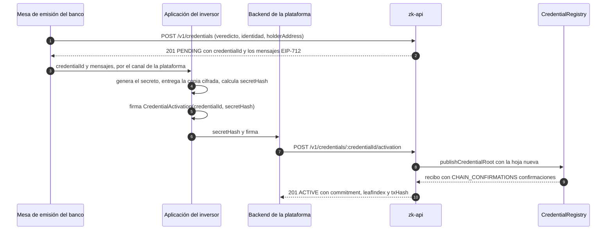
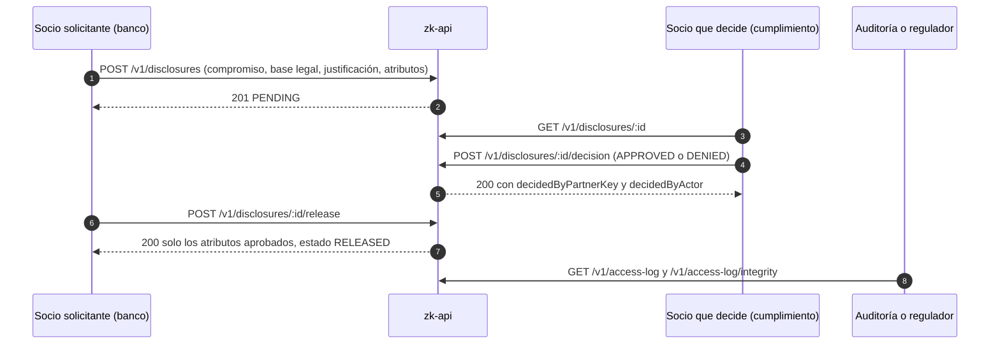
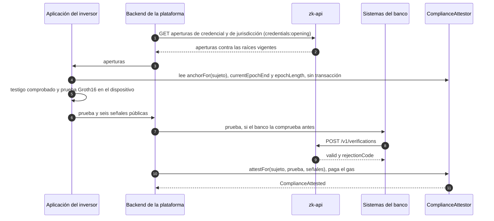

**TRU Web3**

**Manual de usuario y de operación del sistema**

Capa de Confidencialidad Institucional (Secreto Bancario) con Pruebas de Conocimiento Cero

| Documento | Manual de usuario y de operación del sistema |
|---|---|
| **Proyecto** | Capa de Confidencialidad Institucional con ZKP |
| **Cliente** | VCSoft S.A.S. |
| **Proveedor** | TRU Web3 |
| **Fecha** | 13 de octubre de 2026 |
| **Versión** | 1.0 |
| **Base descrita** | Commit `9875612` del repositorio |

**Cómo leer este manual.** Está escrito por públicos. Todos leen la Parte I. Después, cada uno va a
la suya: quien opera el servicio, a la II; quien integra los sistemas del banco, a la III; las áreas
de cumplimiento y los reguladores, a la IV; quien construye la aplicación del inversor, a la V.
Cuando algo falla, el [Anexo C](#anexo-c-qué-hacer-si-algo-sale-mal) lleva del síntoma a la sección
que lo resuelve.

**Convenciones.** Los comandos, rutas, variables y nombres de código van tal cual, en `monoespaciado`.
Las rutas de comandos son relativas a la raíz del repositorio. Las cifras de rendimiento, capacidad y
gas salen del [informe técnico de pruebas de seguridad y estrés](INFORME-SEGURIDAD-Y-ESTRES.md) y se
citan como «IS §n»; se midieron en una estación de trabajo con un único proceso del servicio (IS §2.1)
y en Base Sepolia, y son referencia, no garantía de otro entorno.

# Tabla de contenidos

- [Parte I. Introducción](#parte-i-introducción)
  - [1. Qué es y qué demuestra](#1-qué-es-y-qué-demuestra)
  - [2. Roles y componentes](#2-roles-y-componentes)
  - [3. Requisitos y puesta en marcha](#3-requisitos-y-puesta-en-marcha)
- [Parte II. Operador de la plataforma](#parte-ii-operador-de-la-plataforma)
  - [4. Secretos y su custodia](#4-secretos-y-su-custodia)
  - [5. Socios y alcances](#5-socios-y-alcances)
  - [6. Emisión en dos tiempos](#6-emisión-en-dos-tiempos)
  - [7. Revocación y suspensión](#7-revocación-y-suspensión)
  - [8. Jurisdicciones](#8-jurisdicciones)
  - [9. Rotación de claves](#9-rotación-de-claves)
  - [10. Reconstrucción y reconciliación](#10-reconstrucción-y-reconciliación)
  - [11. Registro de accesos](#11-registro-de-accesos)
  - [12. Operación en Base Sepolia](#12-operación-en-base-sepolia)
  - [13. Respaldos y recuperación ante desastres](#13-respaldos-y-recuperación-ante-desastres)
  - [14. Runbooks de incidentes](#14-runbooks-de-incidentes)
  - [15. Catálogo de errores](#15-catálogo-de-errores)
  - [16. Límites y riesgos que hay que vigilar](#16-límites-y-riesgos-que-hay-que-vigilar)
  - [17. Paso a producción](#17-paso-a-producción)
- [Parte III. Integrador del banco](#parte-iii-integrador-del-banco)
  - [18. Firma de peticiones](#18-firma-de-peticiones)
  - [19. Alcances por ruta](#19-alcances-por-ruta)
  - [20. Veredicto de identidad y activación](#20-veredicto-de-identidad-y-activación)
  - [21. Verificar una prueba](#21-verificar-una-prueba)
  - [22. Cumplimiento y estado de la credencial](#22-cumplimiento-y-estado-de-la-credencial)
  - [23. Divulgación desde el banco](#23-divulgación-desde-el-banco)
  - [24. Errores y reintentos](#24-errores-y-reintentos)
- [Parte IV. Cumplimiento y regulador](#parte-iv-cumplimiento-y-regulador)
  - [25. Flujo de divulgación](#25-flujo-de-divulgación)
  - [26. Qué queda registrado y qué no](#26-qué-queda-registrado-y-qué-no)
  - [27. Garantías y límites de la prueba](#27-garantías-y-límites-de-la-prueba)
  - [28. Evidencia disponible](#28-evidencia-disponible)
- [Parte V. Desarrollador de la aplicación del inversor](#parte-v-desarrollador-de-la-aplicación-del-inversor)
  - [29. Qué debe hacer la aplicación](#29-qué-debe-hacer-la-aplicación)
  - [30. Copia de seguridad cifrada obligatoria](#30-copia-de-seguridad-cifrada-obligatoria)
  - [31. Pérdida de la billetera o de la copia](#31-pérdida-de-la-billetera-o-de-la-copia)
  - [32. Entropía del secreto](#32-entropía-del-secreto)
  - [33. Presentación de la prueba, aperturas y renovación](#33-presentación-de-la-prueba-aperturas-y-renovación)
- [Anexos](#anexos)
  - [Anexo A. Glosario](#anexo-a-glosario)
  - [Anexo B. Tablas de estados](#anexo-b-tablas-de-estados)
  - [Anexo C. Qué hacer si algo sale mal](#anexo-c-qué-hacer-si-algo-sale-mal)
  - [Anexo D. Preguntas frecuentes](#anexo-d-preguntas-frecuentes)
  - [Anexo E. Variables de entorno](#anexo-e-variables-de-entorno)
  - [Anexo F. Scripts](#anexo-f-scripts)
  - [Anexo G. Referencia de la API](#anexo-g-referencia-de-la-api)

# Parte I. Introducción

## 1. Qué es y qué demuestra

La capa de confidencialidad permite que un inversor demuestre que está autorizado a operar un activo
tokenizado bajo el estándar ERC-3643 (identidad verificada por el banco, verificación vigente,
jurisdicción admitida por el activo) **sin que nada de eso quede publicado en la cadena**. Se monta
sobre la plataforma de tokenización sin reemplazarla: el motor de cumplimiento del token sigue
decidiendo cada transferencia, pero decide contra una **atestación** obtenida con una prueba de
conocimiento cero, en lugar de contra datos de identidad públicos.

**Qué demuestra la prueba**, sin revelar quién es el inversor ni dónde reside:

1. Que tiene una credencial emitida por el emisor de la plataforma y que esa credencial sigue en el
   registro (no ha sido revocada ni suspendida).
2. Que la credencial sigue vigente al final del periodo para el que pide la atestación.
3. Que su jurisdicción está en el conjunto que el activo admite.
4. Que el identificador de un solo uso que presenta (el *nulificador*) sale de esa credencial, de ese
   activo y de ese periodo, de modo que no puede usar la misma credencial dos veces en el mismo
   periodo y activo.

**Cómo se usa.** La aplicación del inversor genera la prueba en su dispositivo. La plataforma la
presenta en cadena en nombre del inversor con `ComplianceAttestor.attestFor` y paga el gas; el
inversor no envía ninguna transacción. El contrato comprueba la prueba y escribe una atestación para
la dirección del inversor, válida hasta el final del periodo reclamado (30 días en el despliegue de
Base Sepolia). Mientras la atestación está viva, el módulo de cumplimiento del token
(`ZKComplianceModule`) admite a esa dirección como **receptora** de transferencias y emisiones. Al
final de cada periodo se renueva con una prueba nueva (§33).

**Qué queda en la cadena y qué no.**

| Público en cadena | Nunca en cadena |
|---|---|
| Las raíces de los dos árboles (credenciales y jurisdicciones) | Nombre, documento, país o cualquier dato personal |
| Compromisos de credencial, como números sin significado aparente | La jurisdicción y la caducidad de cada credencial |
| La atestación de cada dirección: hasta cuándo y con qué nulificador | Qué dirección corresponde a qué compromiso |
| Direcciones, saldos y montos de las transferencias del token | El secreto del inversor |

La ofuscación de montos está fuera del alcance del proyecto: los saldos y transferencias del token
siguen siendo públicos como en cualquier token ERC-3643.

**Qué no hace.** No sustituye la verificación de identidad del banco: la recibe como veredicto. No
reemplaza al registro de identidades del estándar: para recibir el token, la dirección tiene que
estar además verificada en el `IdentityRegistry` del activo. La identidad del titular se guarda
cifrada fuera de la cadena y solo se libera mediante el flujo de divulgación autorizada (Parte IV).

## 2. Roles y componentes

### 2.1 Roles de personas y sistemas

| Rol | Qué hace | Parte del manual |
|---|---|---|
| Operador de la plataforma | Despliega y mantiene `zk-api`, custodia sus secretos, da de alta socios, reconcilia y atiende incidentes | II |
| Backend de la plataforma | Actúa por el inversor ante la API (activación, aperturas), presenta las pruebas con `attestFor`, corta atestaciones con `revokeAttestation` y es agente del token | II, V |
| Mesa de emisión del banco | Registra el veredicto de la verificación de identidad (`POST /v1/credentials`) | III |
| Sistemas del banco | Verifican pruebas, consultan cumplimiento y estado de credenciales, piden divulgaciones | III |
| Área de cumplimiento y regulador | Deciden las solicitudes de divulgación y auditan el registro de accesos | IV |
| Aplicación del inversor | Genera y custodia el secreto, firma, construye la prueba en el dispositivo | V |

En la API, cada sistema que llama es un **socio** con una clave, un secreto y unos alcances (§5). Las
personas no se autentican ante la API; el socio puede nombrar en cada petición a la persona por la
que actúa (cabecera `X-Partner-Actor`), y ese nombre queda en el registro de accesos.

### 2.2 Componentes

| Componente | Dónde | Qué es |
|---|---|---|
| Circuito | `zk-circuits/` | Circuito Circom que expresa los cuatro predicados y genera las pruebas Groth16 (y PLONK, como alternativa medida) |
| `CredentialRegistry` | `zk-contracts/` | Guarda la raíz del árbol de credenciales y la de jurisdicciones de cada activo. Solo el emisor publica |
| `ComplianceAttestor` | `zk-contracts/` | Verifica la prueba, gasta el nulificador y escribe la atestación (`attestFor`, `attest`). Permite cortar una atestación (`revokeAttestation`) |
| Verificador y adaptador | `zk-contracts/` | `Groth16Verifier` y `Groth16VerifierAdapter`, detrás de la interfaz `IProofVerifier` |
| `ZKComplianceModule` | `zk-contracts/` | Módulo de cumplimiento ERC-3643: admite al receptor si tiene atestación viva para el activo |
| `zk-api` | `zk-api/` | Emisor de credenciales, divulgación autorizada y API de verificación. PostgreSQL guarda su estado; Redis, los nonces de las firmas |
| Cliente de referencia | `zk-holder/` | Biblioteca con lo que hace la aplicación del inversor y la presentación de la plataforma |

### 2.3 Roles en cadena

| Contrato | Rol | Permite |
|---|---|---|
| `CredentialRegistry` | `DEFAULT_ADMIN_ROLE` | Conceder y retirar roles; cambiar la ventana de validez de raíces |
| `CredentialRegistry` | `ISSUER_ROLE` | Publicar e invalidar raíces de credenciales. Lo usa `zk-api` (`ISSUER_PRIVATE_KEY`) |
| `CredentialRegistry` | `JURISDICTION_ROLE` | Publicar e invalidar raíces de jurisdicciones. Lo usa `zk-api` |
| `ComplianceAttestor` | `DEFAULT_ADMIN_ROLE` | Cambiar el verificador montado y la longitud del periodo |
| `ComplianceAttestor` | `ATTESTATION_MANAGER_ROLE` | `revokeAttestation` |
| `ZKComplianceModule` | `owner` | Cambiar el atestador, liberar un `assetId`, autorizar actualizaciones |
| Token ERC-3643 | agente | Emitir, congelar, transferencias forzadas y recuperación de direcciones (funciones del estándar) |
| `ComplianceAttestor` | ninguno | `attestFor` lo puede llamar cualquiera: la prueba solo puede atestiguar a la dirección que nombra |

## 3. Requisitos y puesta en marcha

### 3.1 Requisitos

- Node 22 y npm.
- Docker, para PostgreSQL 16 y Redis 7 (`zk-api/docker-compose.yml`).
- Un proveedor RPC de la red EVM donde están desplegados los contratos.
- Los artefactos del circuito que corresponden al verificador desplegado:
  `zk-circuits/build/compliance_js/compliance.wasm`, `zk-circuits/build/groth16.zkey` y
  `zk-circuits/build/groth16.vkey.json`. No se versionan; ver §13.

### 3.2 Puertos

Ningún servicio usa su puerto por defecto; todos se fijan por variable de entorno.

| Servicio | Puerto | Variable |
|---|---|---|
| API (`zk-api`) | 3060 | `API_PORT` |
| PostgreSQL | 5452 | `POSTGRES_PORT` |
| Redis | 6399 | `REDIS_PORT` |
| Nodo local Hardhat | 8565 | `HARDHAT_PORT` (en `zk-contracts`) |

### 3.3 Configuración

`zk-api` lee `.env`, o el fichero que nombre `DOTENV_CONFIG_PATH`. Valida todas las variables al
arrancar y se niega a arrancar con un error `invalid_configuration: …` que nombra cada variable
incorrecta. Las variables, con su valor por defecto cuando lo tienen, están en el
[Anexo E](#anexo-e-variables-de-entorno). Las que más importan al operar:

- **De cadena:** `CHAIN_RPC_URL`, `CHAIN_ID`, `CREDENTIAL_REGISTRY_ADDRESS`,
  `COMPLIANCE_ATTESTOR_ADDRESS`, `REGISTRY_DEPLOYMENT_BLOCK`, `ISSUER_PRIVATE_KEY`,
  `CHAIN_CONFIRMATIONS` y `CHAIN_LOG_BLOCK_RANGE`.
- **De prueba:** `PROOF_SCHEME` y `PROOF_VERIFICATION_KEY_PATH`, que tienen que corresponder al
  adaptador montado en `ComplianceAttestor` (Groth16 en Base Sepolia).
- **Secretos:** `SUBJECT_REFERENCE_KEY`, `DISCLOSURE_VIEWING_KEYS`, `DISCLOSURE_ACTIVE_VIEWING_KEY`,
  `PARTNER_SECRET_ENCRYPTION_KEY` y `ACCESS_LOG_HMAC_KEY` (§4).
- **De capacidad:** `ISSUER_WRITE_QUEUE_LIMIT` y `PARTNER_SIGNATURE_WINDOW_SECONDS`.

### 3.4 Arranque contra Base Sepolia

El entorno operativo de este repositorio es Base Sepolia, con un fichero de configuración propio
(`zk-api/.env.testnet`, fuera de git) y almacenes propios para que la suite de pruebas no los toque.

```bash
cd zk-api
npm install
cp .env.example .env.testnet
npm run keys:generate        # imprime un juego de secretos nuevo; se copia a .env.testnet
docker-compose up -d         # PostgreSQL en 5452 y Redis en 6399
docker exec zk-api-postgres sh -c 'psql -U "$POSTGRES_USER" -d "$POSTGRES_DB" -c "CREATE DATABASE zkapi_testnet"'
npm run prisma:migrate:testnet
npm run start:testnet        # API en el API_PORT de .env.testnet
curl http://127.0.0.1:3060/health
```

En `.env.testnet` se fijan, además de los secretos: `CHAIN_ID=84532`; las direcciones del registro y
del atestador y `REGISTRY_DEPLOYMENT_BLOCK=48076954`, de `zk-contracts/deployments/baseSepolia.json`
(§12); `CHAIN_CONFIRMATIONS=2`; `CHAIN_LOG_BLOCK_RANGE` según el proveedor (§14.7); la clave de la
billetera con `ISSUER_ROLE` como `ISSUER_PRIVATE_KEY`; una base de datos y un índice de Redis propios
(`…/zkapi_testnet` y `redis://…/1`). `npm test` vacía la base de datos de `TEST_DATABASE_URL` y el
Redis que usa: nunca deben coincidir con los de operación.

Cada versión que trae una migración nueva exige `npm run prisma:migrate:testnet` antes de arrancar.
La de la versión final, `20261013200000_root_window_closure`, añade a `root_publications` la
credencial que cambió cada publicación y el estado del cierre de la ventana de la raíz anterior
(§7.1).

`GET /health` responde `{"status":"ok","service":"zk-api"}` sin tocar la base de datos, Redis ni la
cadena: dice que el proceso está vivo, no que sus dependencias respondan. La especificación de la API
se sirve, sin autenticación, en `/api/docs` (navegable) y `/api/openapi.yaml` (documento).

Para detener el servicio se usa `SIGTERM` o `SIGINT` (Ctrl+C): antes de salir vacía la cola del
registro de accesos (§11). Un proceso terminado a la fuerza pierde las entradas que no había escrito.

### 3.5 Suites de pruebas

| Proyecto | Comando | Requiere |
|---|---|---|
| `zk-circuits` | `npm test` | Compila el circuito |
| `zk-contracts` | `npx hardhat test` | Nada externo |
| `zk-api` | `npm run typecheck && npm test` | `docker start zk-api-postgres zk-api-redis` y `TEST_DATABASE_URL` |
| `zk-holder` | `npm run typecheck && npm test` | Los artefactos del circuito y `zk-api` con dependencias instaladas |

Resultados de referencia: 39, 129, 291 y 25 pruebas en verde (`docs/evidencias/INDICE.md`).

# Parte II. Operador de la plataforma

## 4. Secretos y su custodia

`zk-api` maneja cinco secretos propios y los secretos de los socios. Ninguno de ellos permite
reconstruir el secreto de un inversor: ese valor nace en la aplicación del inversor y nunca llega al
servicio. En producción viven en el gestor de secretos del entorno cloud; aquí, en `.env.testnet`
(permisos `600`, fuera de git).

| Secreto | Para qué sirve | Si se pierde | Si se filtra | Rotación |
|---|---|---|---|---|
| `ISSUER_PRIVATE_KEY` | Firma la publicación de raíces (`ISSUER_ROLE`, `JURISDICTION_ROLE`) | No se puede emitir, revocar ni cambiar jurisdicciones | Quien la tenga publica raíces a voluntad | Sí, en cadena: §9.2 |
| `SUBJECT_REFERENCE_KEY` | Ciega el identificador del banco (`kycSubjectId`) para el control de duplicados | Se pierde el control de duplicados hacia atrás; ninguna credencial | Con la base de datos, permite comprobar si un identificador conocido tiene credencial | Exige que el banco reenvíe los identificadores; sin herramienta |
| `DISCLOSURE_VIEWING_KEYS` | Claves privadas X25519 que abren las identidades selladas | **Nadie puede atender una divulgación** hasta que la clave vuelva | Con la base de datos, abre cualquier identidad **fuera del flujo y sin registro** | Sí: §9.1 |
| `PARTNER_SECRET_ENCRYPTION_KEY` | Envuelve los secretos de los socios en la base de datos | Ningún socio autentica (`partner_secret_unreadable`) | Con la base de datos, revela el secreto de todos los socios | Sin herramienta: equivale a dar de alta todos los socios otra vez |
| `ACCESS_LOG_HMAC_KEY` | Encadena el registro de accesos | La cadena ya no se puede verificar | Con escritura en la tabla, permite anexar entradas falsas indetectables | No rotable: cambiarla hace fallar la verificación desde la primera entrada |
| Secreto de cada socio | Firma HMAC de sus peticiones | El socio no puede llamar | Se puede suplantar al socio | Sí: `partner:rotate-secret` (§5.4) |

`DISCLOSURE_ACTIVE_VIEWING_KEY` no es un secreto, sino el **identificador** de la clave contra la que
se sellan las identidades nuevas. Es obligatorio y no tiene valor por defecto. Tiene que nombrar una
clave presente en `DISCLOSURE_VIEWING_KEYS`; si no, el servicio no arranca
(`invalid_configuration: DISCLOSURE_ACTIVE_VIEWING_KEY "…" has no material`). Es también el destino
por defecto de la rotación (§9.1).

**Reglas de custodia.**

- `npm run keys:generate` imprime los secretos por la salida estándar y no escribe nada en disco. Se
  copian al gestor de secretos y se limpia el historial de la terminal; no se pegan en tickets,
  chats ni logs.
- `ISSUER_PRIVATE_KEY` la usa **un único proceso**: una sola instancia de `zk-api` (§16), y ningún
  otro sistema. El servicio lleva sus nonces en memoria y supone que nadie más firma con esa clave.
  La billetera con la que el backend de la plataforma presenta pruebas (`attestFor`) o corta
  atestaciones (`revokeAttestation`) debería ser otra. En Base Sepolia, por economía de la prueba,
  una misma billetera (Y) hizo los tres papeles y las operaciones se hicieron en secuencia.
- Las claves de visualización son el activo más sensible: quien las tiene, junto con una copia de la
  base de datos, lee identidades sin dejar rastro en el registro de accesos (§26).
- El secreto de un socio se imprime **una sola vez**, al crearlo. El servicio solo guarda una copia
  envuelta.

## 5. Socios y alcances

### 5.1 Alta de un socio

```bash
cd zk-api
DOTENV_CONFIG_PATH=.env.testnet npm run partner:create -- "<nombre>" <alcance> [<alcance> ...]
```

La salida es un JSON con `id`, `partnerKey` (de la forma `pk_…`), `name`, `scopes` y `secret`, seguido
de «The secret is shown once». El `partnerKey` y el `secret` se entregan al socio por un canal
seguro. Un alcance que no existe se rechaza con `unknown scopes: …` y no se crea nada.

### 5.2 Los catorce alcances

| Alcance | Permite |
|---|---|
| `proofs:verify` | Verificar una prueba (`POST /v1/verifications`) |
| `proofs:read` | Consultar la vigencia de una verificación |
| `compliance:read` | Consultar el estado de cumplimiento de una dirección en un activo |
| `credentials:read` | Consultar el estado de una credencial por su compromiso |
| `credentials:issue` | Registrar el veredicto de identidad (paso 1 de la emisión) |
| `credentials:activate` | Completar la credencial con el `secretHash` del inversor (paso 2) |
| `credentials:revoke` | Revocar, suspender, reinstaurar y cancelar credenciales |
| `credentials:opening` | Leer las aperturas que hacen falta para construir una prueba |
| `jurisdictions:write` | Fijar el conjunto de jurisdicciones de un activo |
| `disclosures:request` | Abrir una solicitud de divulgación |
| `disclosures:read` | Leer el estado de una solicitud y liberar la propia, ya aprobada |
| `disclosures:approve` | Aprobar o denegar solicitudes de otros socios |
| `audit:read` | Leer el registro de accesos y comprobar su integridad |
| `issuer:admin` | Reconstruir el estado desde la cadena y rotar las claves de visualización |

Los alcances **no son jerárquicos**: `issuer:admin` no incluye `credentials:opening` ni ningún otro.
La tabla completa de qué ruta exige qué alcance está en §19.

### 5.3 Perfiles recomendados

| Socio | Alcances |
|---|---|
| Backend de la plataforma | `credentials:activate` `credentials:opening` `credentials:read` |
| Mesa de emisión del banco | `credentials:issue` `credentials:revoke` `credentials:read` |
| Responsable de las jurisdicciones del activo | `jurisdictions:write` |
| Sistemas del banco | `proofs:verify` `proofs:read` `compliance:read` `credentials:read` `disclosures:request` `disclosures:read` |
| Cumplimiento | `disclosures:approve` `disclosures:read` |
| Auditoría o regulador | `audit:read` |
| Operador | `issuer:admin` |

Tres separaciones que los perfiles respetan a propósito:

- `credentials:issue` y `credentials:activate` en socios distintos: la mesa que registra el veredicto
  no puede completar la credencial en lugar del inversor.
- `credentials:opening` fuera del operador: quien reconstruye el estado y rota claves no lee
  aperturas.
- Quien pide una divulgación nunca la decide, tenga los alcances que tenga (§23), pero conviene
  igualmente no dar `disclosures:approve` a quien pide.

### 5.4 Suspender un socio o cambiar su secreto

Desde el servidor, con el fichero de configuración del entorno:

```bash
cd zk-api
DOTENV_CONFIG_PATH=.env.testnet npm run partner:list
DOTENV_CONFIG_PATH=.env.testnet npm run partner:suspend -- <partnerKey>
DOTENV_CONFIG_PATH=.env.testnet npm run partner:reactivate -- <partnerKey>
DOTENV_CONFIG_PATH=.env.testnet npm run partner:rotate-secret -- <partnerKey>
```

- `partner:list` imprime de cada socio su `partnerKey`, nombre, estado, alcances y última
  modificación. Nunca el secreto.
- `partner:suspend` deja al socio en `SUSPENDED`: su siguiente petición recibe
  `403 partner_suspended`, firmada como sea, y queda en el registro de accesos.
  `partner:reactivate` lo devuelve a `ACTIVE`. Ninguno de los dos toca lo que el socio hizo antes.
- `partner:rotate-secret` sustituye el secreto sin cambiar nada más: el socio conserva su
  `partnerKey`, sus alcances y su historia, y desde ese momento una firma con el secreto anterior
  recibe `401 invalid_signature`. El secreto nuevo se imprime **una sola vez**, como en el alta, y
  se entrega por un canal seguro.
- Una `partnerKey` que no existe termina con código 1 («no partner holds the key …»); una acción
  desconocida, con código 2 y el modo de uso.

Ante la sospecha de que un secreto se filtró: rotarlo de inmediato y revisar en el registro de
accesos las peticiones de ese socio desde la última fecha de confianza (§11.3). Para retirar un
socio de forma definitiva: suspenderlo. Estos cambios se escriben directamente en la base de datos,
sin pasar por la API, así que no dejan entrada en el registro de accesos: se anotan como cambio
operativo.

## 6. Emisión en dos tiempos

El valor central de una credencial pertenece al inversor: el emisor no lo conoce ni puede calcularlo.
Por eso la emisión tiene dos pasos, de dos socios distintos.



**Paso 1, el veredicto.** La mesa envía `kycSubjectId` (identificador propio del banco; no se
guarda, solo su HMAC), `holderAddress` (la billetera sobre la que se hizo la verificación),
`verification` (`approved`, `countryCode` ISO 3166-1 numérico, `expiresAt` futura, `reference`) e
`identity` (al menos `legalName`, `documentType`, `documentNumber`, `countryCode`). La identidad se
sella en ese momento contra la clave de visualización activa. La credencial nace `PENDING`: sin
compromiso, sin posición en el árbol, sin nada publicado. Detalle para el integrador en §20.

**Paso 2, la activación.** La aplicación del inversor entrega `secretHash` y una firma EIP-712 que
prueba que es la billetera verificada (Parte V). Solo entonces se construye la hoja, se asigna
posición y se publica la raíz. La respuesta trae `commitment`, `leafIndex`, `credentialRoot` y
`txHash`. En Base Sepolia una activación tarda 4,5–5,6 s con dos confirmaciones (IS §5.12); en local,
19,9 ms más 1,93 ms por credencial ya emitida, ~1,9 s con 1 000 (IS §5.4).

**Reglas de unicidad** (las aplica la base de datos):

- Una credencial **viva** (`PENDING`, `ACTIVE` o `SUSPENDED`) por persona. Una segunda emisión para
  la misma persona da `409 credential_already_issued`.
- Un `secretHash` por sistema, en todas las credenciales que hayan existido:
  `409 secret_hash_already_used`. Una reemisión exige un secreto nuevo.
- **La caducidad no libera el hueco.** Una credencial vencida sigue ocupándolo hasta que se revoca
  (§7).

**Cancelar una inscripción abandonada.** Si el inversor nunca activó,
`POST /v1/credentials/:credentialId/cancellation` (alcance `credentials:revoke`) la pasa a `REVOKED`
sin publicar nada y libera el hueco de esa persona. Sobre una credencial que no está `PENDING`
responde `409 credential_not_pending`.

Errores frecuentes del paso 2 y qué significan: `credential_not_pending` (ya activada o cancelada),
`credential_expired` (venció la verificación antes de activar: cancelar y emitir de nuevo),
`activation_signature_mismatch` (firmó otra billetera), `holder_is_contract_account` (la dirección es
un contrato: hay que emitir para una cuenta normal), `credential_tree_full` (árbol lleno, §16). Si la
publicación falla, la credencial vuelve a `PENDING` sin compromiso ni posición.

## 7. Revocación y suspensión

### 7.1 Lo que hace cada operación

| Operación | Ruta (alcance `credentials:revoke`) | Efecto |
|---|---|---|
| Revocar | `POST /v1/credentials/:commitment/revocation` | Quita la hoja, publica la raíz nueva y, por defecto, cierra la ventana de la raíz anterior. Definitiva. Sobre una suspendida, la retira sin publicar nada (§7.5) |
| Suspender | `POST /v1/credentials/:commitment/suspension` | Igual, pero reversible |
| Reinstaurar | `DELETE /v1/credentials/:commitment/suspension` | Devuelve la hoja a su misma posición y publica la raíz |
| Cancelar | `POST /v1/credentials/:credentialId/cancellation` | Solo para `PENDING`: no publica nada |

Las dos primeras aceptan el cuerpo `{"closeRootWindow": true}` (el valor por defecto) o `false`. El
cuerpo es opcional: sin él se aplica el valor por defecto. La respuesta trae `previousRoot`,
`credentialRoot`, `txHash` y `previousRootInvalidated`.

**Si la publicación se confirma y el cierre de la ventana falla**, la operación no se deshace: la
cadena ya tiene la raíz nueva y la base de datos la refleja (la credencial queda `REVOKED` o
`SUSPENDED`, fuera del árbol). La respuesta es `424 root_invalidation_pending`, con la operación en
`details` (`status`, `previousRoot`, `credentialRoot`, `txHash` y `previousRootInvalidated: false`)
y el fallo en `details.cause`. El cierre queda pendiente y **repetir la misma petición** lo reintenta:
responde `200` con `previousRootInvalidated: true`. Si el intento fallido sí llegó a minarse, o si la
ventana ya venció, la repetición lo reconoce sin enviar nada. Mientras está pendiente, la
reconciliación lo lista en `pendingRootInvalidations` (§10.2). Repetir con `{"closeRootWindow":
false}` no lo cierra y responde `409 credential_not_in_tree`.

### 7.2 Las dos ventanas que hay que cerrar

Quitar la hoja no corta todo de inmediato. Quedan dos ventanas abiertas:

1. **La de la raíz anterior.** El registro sigue aceptando una raíz sustituida durante
   `rootValidityWindow` (900 s en Base Sepolia), y contra ella la credencial revocada todavía prueba.
   `closeRootWindow: true` la invalida en la misma operación (`invalidateCredentialRoot`). Coste:
   las pruebas que **otros** inversores construyeron contra esa raíz en esos minutos también se
   rechazan; vuelven a pedir su apertura y prueban de nuevo, sin perder nada.
2. **La atestación ya concedida.** Vive hasta el final del periodo que reclamó, hasta dos periodos
   (60 días en Base Sepolia; `zk-circuits/NOTAS-CIRCUITO.md` §5.2). **Revocar la credencial no la
   corta.** Hay que llamar en cadena a `ComplianceAttestor.revokeAttestation(assetId, subject)` con la billetera que tiene
   `ATTESTATION_MANAGER_ROLE`, para cada activo y cada dirección del inversor.

Sin cerrar ninguna de las dos, la latencia máxima de una revocación es
`rootValidityWindow + 2 × epochLength`, es decir 15 minutos más 60 días con los parámetros de Base
Sepolia.

### 7.3 Revocar no congela el saldo

El módulo de cumplimiento solo mira al **receptor** de una transferencia. Tras revocar la credencial
y la atestación, el inversor ya no puede recibir, pero conserva sus tokens y puede enviarlos a un
receptor conforme. En la corrida de Base Sepolia, el inversor revocado conservó los 250 ZKCTA que
había recibido. Si la política exige inmovilizar el saldo, se usan las funciones del estándar
ERC-3643, que ejecuta un agente del token: `setAddressFrozen(dirección, true)`,
`freezePartialTokens(dirección, cantidad)` o `forcedTransfer`.

Las dos primeras tienen tarea en `zk-contracts`, que firma con la billetera agente del token (Y en
Base Sepolia, `PLATFORM_PRIVATE_KEY` en `zk-contracts/.env`):

```bash
cd zk-contracts
npx hardhat token:freeze   --network baseSepolia --holder <dirección>               # congela la dirección
npx hardhat token:freeze   --network baseSepolia --holder <dirección> --amount 250  # congela 250 tokens
npx hardhat token:unfreeze --network baseSepolia --holder <dirección> [--amount 250]
```

Toman el token de `deployments/baseSepolia.json` (o de `--token`), comprueban antes de enviar que la
billetera es agente y que la cantidad cabe en el saldo libre o en el congelado, imprimen el estado
antes y después, y esperan dos confirmaciones. Con `--dry-run` comprueban y no envían nada. Con la
dirección congelada el inversor no envía ni recibe; con una parte congelada, solo dispone del resto.
`forcedTransfer` y `recoveryAddress` no tienen tarea: se hacen desde la pestaña de escritura del
token en el explorador, con la misma billetera.

### 7.4 Procedimiento completo de revocación

1. `POST /v1/credentials/:commitment/revocation`, sin cuerpo o con `{"closeRootWindow": true}`. Leer
   en la respuesta `status: "REVOKED"` y `previousRootInvalidated: true`. Si responde
   `424 root_invalidation_pending`, repetir la petición (§7.1).
2. `revokeAttestation(assetId, subject)` por cada activo en el que el inversor tenga atestación. La
   dirección es la que la plataforma usó al presentar (`attestFor`). Desde `zk-contracts`, con la
   billetera que tiene `ATTESTATION_MANAGER_ROLE` (Y en Base Sepolia):

   ```bash
   npx hardhat attestation:revoke --network baseSepolia --subject <dirección>
   ```

   Toma el atestador y el `assetId` de `deployments/baseSepolia.json` (o de `--attestor` y
   `--asset`), comprueba el rol, imprime la atestación que corta y espera dos confirmaciones. Si no hay
   atestación lo dice y no envía nada, que no es un fallo. `--dry-run` comprueba sin enviar. También
   se puede hacer desde el backend de la plataforma o desde la pestaña de escritura del contrato
   verificado en el explorador.
3. Si la política lo pide, congelar el saldo (§7.3).
4. Comprobar: `GET /v1/credentials/:commitment` da `REVOKED` e `inRegistry: false`;
   `GET /v1/compliance/assets/:assetId/subjects/:subject` da `compliant: false`.

En Base Sepolia una revocación con cierre de ventana tarda ~11 s (dos transacciones con dos
confirmaciones cada una, IS §5.12), y cuesta del orden de 59 660 gas de publicación más 28 005 de
invalidación; `revokeAttestation`, 29 476 (IS §6).

### 7.5 Suspensión y retirada definitiva de una suspendida

Una credencial suspendida ya está fuera del árbol. Para retirarla de forma definitiva se revoca:
`POST /v1/credentials/:commitment/revocation`. Como su hoja no está en el árbol, no se publica nada:
la credencial pasa a `REVOKED` y libera el hueco de la persona. La respuesta describe la publicación
que la sacó del árbol, la de la suspensión, con `previousRootInvalidated` según se cerró entonces la
ventana; si aquel cierre quedó pendiente, la revocación lo reintenta. Vale igual si la credencial ya
caducó, que es justo el caso en que la reinstauración responde `409 credential_expired`.

No hay que reinstaurarla antes de revocarla: eso volvería a poner la hoja en cadena entre dos
publicaciones. En una credencial suspendida con una versión anterior del servicio, que no tiene
publicación enlazada, `txHash` llega `null`.

### 7.6 Después de cerrar la ventana

Cerrar la ventana de la raíz cambia la vigencia de verificaciones ajenas: una verificación anterior
de **otro** inversor pasa a `standing: "superseded_root"` aunque su atestación siga viva y siga
siendo conforme. La pregunta «¿esta dirección es conforme hoy?» se responde con
`GET /v1/compliance/assets/:assetId/subjects/:subject`, no con la vigencia de una verificación
anterior (§21).

## 8. Jurisdicciones

`PUT /v1/assets/:assetId/jurisdictions` (alcance `jurisdictions:write`) con
`{"admitted": [170, 484]}` **reemplaza** el conjunto de países que el activo admite, con códigos ISO
3166-1 numéricos entre 1 y 65535, hasta 256 por activo. El servicio publica la raíz nueva y responde
con `admitted`, `countryRoot`, `txHash`, `leafCount` y `previousRootInvalidated`.

- Un país que sigue admitido conserva su posición y su apertura; solo se emiten en cadena los códigos
  que cambian.
- El mismo conjunto que ya está publicado da `409 jurisdiction_set_unchanged`.
- Más de 256 países da `400 validation_failed`; el árbol no admite más (IS §5.8).
- Hasta que un activo tiene su primer conjunto publicado, `GET /v1/compliance/…` responde
  `404 asset_not_registered`, y el atestador rechaza cualquier prueba para ese activo.
- **Quitar un país cierra por defecto la ventana de la raíz anterior** (`invalidateCountryRoot`),
  igual que una revocación: los inversores de ese país dejan de poder obtener atestaciones nuevas en
  ese momento y no cuando vence la ventana (900 s en Base Sepolia). El coste es el mismo que en §7.2:
  las pruebas que inversores de otros países construyeron contra la raíz anterior en esos minutos
  también se rechazan, y vuelven a probar. `{"admitted": […], "closeRootWindow": false}` deja la
  ventana abierta. Añadir países no cierra nada.
- Si solo falla el cierre, el cambio queda publicado y la respuesta es
  `424 root_invalidation_pending`; **enviar de nuevo el mismo conjunto** lo cierra, en vez de
  responder `409 jurisdiction_set_unchanged`.
- **Quitar un país no corta atestaciones vivas.** Las ya concedidas siguen hasta su final, salvo
  `revokeAttestation` (§7.4).
- El `assetId` de la API es el que el módulo de cumplimiento tiene ligado al token (`84532001` en
  Base Sepolia).

Comprobación: `POST /v1/issuer/assets/:assetId/state/rebuild` (§10) debe dar `matchesChain: true`
y las tres listas vacías.

## 9. Rotación de claves

### 9.1 Clave de visualización

Rotar no toca la cadena ni invalida ninguna prueba. Procedimiento, en este orden:

1. Generar un par nuevo con `npm run keys:generate` (de su salida solo se usa la línea
   `DISCLOSURE_VIEWING_KEYS`) y darle un identificador nuevo.
2. Añadirlo a `DISCLOSURE_VIEWING_KEYS` **junto** a la clave vigente, separado por coma
   (`id-anterior:…,id-nuevo:…`), y apuntar `DISCLOSURE_ACTIVE_VIEWING_KEY` al identificador nuevo.
   Reiniciar el servicio. Desde ese momento las identidades nuevas se sellan con la clave nueva.
3. Llamar a `POST /v1/disclosures/viewing-keys/rotation` (alcance `issuer:admin`), sin cuerpo o con
   `{"batchSize": 1000}`. Cada llamada vuelve a sellar hasta `batchSize` sobres (200 por defecto),
   pasando de largo los que no puede abrir, y responde `rotated` (movidos en esta llamada),
   `alreadyCurrent` (ya en la clave destino antes de la llamada), `failed` (credenciales cuyo sobre
   no se pudo abrir en esta llamada) y `remaining` (sobres que siguen fuera de la clave destino).
4. Repetir hasta que `remaining` sea `0`.
5. Solo entonces quitar la clave anterior de `DISCLOSURE_VIEWING_KEYS` y del gestor de secretos.
   Quitarla antes deja sobres que nadie puede abrir hasta que vuelva.

Si una llamada da `rotated: 0` y `remaining` no es `0`, lo que queda son exactamente los sobres de
`failed`: están sellados con una clave que no está configurada, o no autentican. No retirar nada y
revisar qué claves faltan (`viewing_key_unavailable` en una liberación nombra el identificador). Los
sobres que no se pueden abrir no impiden que la rotación alcance a los demás.

### 9.2 Clave del emisor

La clave de `ISSUER_PRIVATE_KEY` se sustituye en cadena:

1. Con la billetera administradora del registro (`DEFAULT_ADMIN_ROLE`, la de despliegue en Base
   Sepolia), conceder `ISSUER_ROLE` y `JURISDICTION_ROLE` en `CredentialRegistry` a la dirección
   nueva. Se puede hacer desde la pestaña de escritura del contrato verificado o con
   `npx hardhat console --network baseSepolia` en `zk-contracts`, que firma con
   `DEPLOYER_PRIVATE_KEY`.
2. Detener `zk-api`, cambiar `ISSUER_PRIVATE_KEY` y arrancarlo.
3. Hacer un cambio de prueba (por ejemplo, reconciliar y luego una activación real) y comprobar el
   firmante de la transacción en el explorador.
4. Retirar los dos roles a la dirección anterior.

### 9.3 Las demás

`SUBJECT_REFERENCE_KEY`, `PARTNER_SECRET_ENCRYPTION_KEY` y `ACCESS_LOG_HMAC_KEY` no tienen
procedimiento de rotación en el código, y cambiarlas tiene las consecuencias de la tabla de §4. Si
una de ellas se filtra, se trata como incidente (§14) antes de cambiar nada.

## 10. Reconstrucción y reconciliación

La cadena guarda cada cambio de hoja como evento (`CredentialLeafUpdated`, `CountryLeafUpdated`). El
servicio puede reproducirlos en orden, reconstruir los árboles y compararlos con lo que el registro
tiene y con lo que la base de datos cree. **Detecta, no repara**: ninguna de las dos vías cambia nada.
Las discrepancias que deja una operación a medias, como un recibo que no llegó a tiempo de una
transacción que sí se minó o un cierre de ventana que falló, se resuelven repitiendo la operación
(§7.1, §14.2).
Para las demás, decidir cuál de las dos versiones es la buena es una decisión operativa (§14.3).

### 10.1 Cómo se lanza

| Qué | Cómo |
|---|---|
| Árbol de credenciales, por HTTP | `POST /v1/issuer/state/rebuild` (alcance `issuer:admin`) |
| Árbol de jurisdicciones de un activo, por HTTP | `POST /v1/issuer/assets/:assetId/state/rebuild` |
| Los dos, desde el servidor | `DOTENV_CONFIG_PATH=.env.testnet npm run issuer:rebuild -- 84532001` |

El script imprime un JSON `{"credentialTree": {…}}`, uno `{"assetId": …, "jurisdictionTree": {…}}`
por cada activo nombrado y, al final, `{"healthy": …, "problems": […]}`. Termina con código 0 solo si
todo está sano: `matchesChain` en todos los árboles, `missingFromDatabase` y `missingFromChain` vacías
en el de credenciales y en el de cada activo nombrado, y ningún cierre de ventana pendiente. Si no,
termina con 1 y `problems` dice qué falla y dónde, así que sirve tal cual como control periódico. Los
activos que no se nombran no se revisan.

Ninguna de las dos vías modifica la base de datos ni la cadena.

### 10.2 Campos de la respuesta

| Campo | Significado |
|---|---|
| `source` | Siempre `chain-events` |
| `events` | Eventos de hoja reproducidos |
| `leafCount` | Hojas presentes en el árbol reconstruido |
| `replayedRoot` | Raíz del árbol reconstruido desde los eventos |
| `onChainRoot` | Raíz que el registro tiene, leída en el mismo bloque |
| `matchesChain` | `replayedRoot == onChainRoot`: la historia de eventos leída está completa y es coherente con la cadena |
| `throughBlock` | Bloque hasta el que se reprodujo y en el que se leyó la raíz |
| `missingFromDatabase` | Compromisos (credenciales) o códigos de país (jurisdicciones) que la cadena tiene y la base de datos no, en esa posición |
| `missingFromChain` | Compromisos o códigos de país que la base de datos cree publicados y la cadena no tiene |
| `pendingRootInvalidations` | Cierres de ventana pedidos que no se completaron: el compromiso de la credencial retirada, o la raíz de jurisdicciones sustituida. Se completan repitiendo la operación (§7.1, §8) |

`matchesChain` compara la cadena consigo misma; la comparación con la base de datos son las listas.
Un estado sano es `matchesChain: true` con las tres listas vacías. Un registro en el que todavía no se
publicó nada tiene raíz `0` y da `matchesChain: true`.

### 10.3 Cómo leer el resultado

| `matchesChain` | `missingFromDatabase` | `missingFromChain` | Qué significa | Qué hacer |
|---|---|---|---|---|
| `true` | vacía | vacía | Base de datos y cadena coinciden | Nada |
| `true` | con elementos | vacía | La cadena tiene hojas que el servicio no registró: una activación (o un país añadido) que se confirmó después de un `chain_receipt_timeout`, o una base de datos restaurada de una copia anterior. Si la credencial no tiene sobre de identidad, nadie podrá atender su divulgación | Tras un `chain_receipt_timeout`: repetir la misma operación (§14.2). Si no: incidente, §14.3 |
| `true` | vacía | con elementos | La base de datos cree en cadena hojas que no están: una revocación, suspensión o retirada de país cuyo recibo no llegó a tiempo y sí se minó, o una reorganización de la cadena más profunda que `CHAIN_CONFIRMATIONS` | Tras un `chain_receipt_timeout`: repetir la misma operación (§14.2). Si no: incidente, §14.3 |
| `true` | vacía | vacía | `pendingRootInvalidations` no vacía: la operación se publicó y el cierre de la ventana falló | Repetir la misma revocación, suspensión o conjunto de jurisdicciones (§7.1, §8) |
| `false` | cualquiera | cualquiera | La reproducción no llega a la raíz real: faltan eventos en la lectura | Repetir; revisar `REGISTRY_DEPLOYMENT_BLOCK`, `CHAIN_LOG_BLOCK_RANGE` y el proveedor (§14.7) |
| No aplica | No aplica | No aplica | `424 chain_call_failed` | La lectura de eventos falló tras los reintentos; no es una discrepancia: §14.7 |

### 10.4 Cuándo ejecutarla

- Tras cualquier `chain_receipt_timeout`, antes de volver a escribir (§14.2).
- Tras una advertencia en el log del servicio «the registry replaced a root this service had not
  recorded as current; reconcile».
- Tras restaurar la base de datos (§13).
- De forma periódica, como control. Su coste depende del proveedor RPC: con 1 000 credenciales,
  ~2 s de cálculo más las llamadas `eth_getLogs`, cuyo número depende de la historia de la cadena y
  del rango por llamada que admita el proveedor (IS §7). Si las reconstrucciones fallan o tardan,
  §14.7.

## 11. Registro de accesos

### 11.1 Qué se registra

Toda petición a `/v1`, concedida o rechazada, **incluidas las que no llegan a una ruta** (firma mala,
ventana vencida, ruta inexistente), deja una entrada. Las dos rutas públicas de la especificación y
`/health` quedan fuera. Cada entrada lleva:

| Campo | Contenido |
|---|---|
| `sequence` | Número correlativo, sin huecos |
| `occurredAt` | Momento de la petición |
| `partnerKey` | Socio que firmó, o el que decía ser, o `anonymous` |
| `actorRef` | La cabecera `X-Partner-Actor`, si vino (declarada, no firmada) |
| `method`, `path` | Método y ruta con su consulta |
| `scope` | Alcance que la ruta exige |
| `resourceType`, `resourceId` | Recurso tocado: `credential`, `credential_opening`, `jurisdiction_opening`, `asset_jurisdictions`, `proof_verification`, `compliance_state`, `disclosure_request`, `disclosure_release`, `viewing_key_rotation`, `access_log`, `issuer_state`, o `authentication` para las que no llegaron a una ruta |
| `outcome` | `granted`, `refused` o `aborted` (el cliente colgó antes de la respuesta; la petición sí se procesó y `statusCode` es 499) |
| `statusCode` | Estado HTTP devuelto |
| `requestDigest` | SHA-256 del cuerpo de la petición |
| `previousHash`, `entryHash` | Eslabones de la cadena |

Los atributos liberados en una divulgación **no** se copian al registro.

### 11.2 Por qué no se puede reescribir

- **Disparadores en PostgreSQL** rechazan `UPDATE`, `DELETE` y `TRUNCATE` sobre
  `access_log_entries`, también para el rol de la aplicación.
- **Cadena de hash con clave:** cada `entryHash` es un HMAC, con `ACCESS_LOG_HMAC_KEY`, de la entrada
  y del hash anterior. Quien escriba en la tabla sin la clave no puede fabricar una entrada que
  verifique.

### 11.3 Consultarlo y verificarlo

- `GET /v1/access-log` (alcance `audit:read`), de la más reciente a la más antigua. Filtros:
  `partnerKey`, `resourceType`, `resourceId`, `from`, `to` (fechas ISO), `limit` (1–200, 50 por
  defecto). Para paginar, se pasa `nextCursor` como `cursor`; `null` es la última página.
- `GET /v1/access-log/integrity` recorre la cadena entera y responde `intact`, `entries` (total),
  `checked` (entradas verificadas antes de la primera rotura), `brokenAtSequence` y `reason`
  (`hash_mismatch`, `predecessor_mismatch` o `sequence_gap`). Tarda 13 µs por entrada, 6,6 s por
  cada medio millón (IS §5.5).

### 11.4 Lo que el operador debe vigilar

- El registro se escribe **después** de responder, en lotes, desde un único escritor por proceso.
  Si un lote no se puede anexar tras cinco intentos, el log del servicio dice «access log entries
  could not be appended» con el número de entradas perdidas. Es una alerta que hay que tener
  configurada.
- La cadena prueba que nada se editó ni se insertó sin la clave, pero no que no falten las
  **últimas** entradas. Conviene que auditoría anote periódicamente, fuera del sistema, el último
  `sequence` y su `entryHash` y los compare en la siguiente revisión.

## 12. Operación en Base Sepolia

### 12.1 Despliegue

Red Base Sepolia (`chainId` 84532), explorador <https://sepolia.basescan.org>. Fuente de verdad:
`zk-contracts/deployments/baseSepolia.json`, que escribe el propio script de despliegue.

| Contrato | Dirección | Bloque |
|---|---|---|
| `Groth16Verifier` | `0xD5417e562083DB6ef071489f2d1A8C0d8d36784d` | 48076942 |
| `Groth16VerifierAdapter` | `0xC2e0400Fedbbb9D200228cFf3D5e95dB26dcbbaA` | 48076951 |
| `CredentialRegistry` | `0xA3fcAb3e8da5546BeBE66A88E581621a8b27B8AA` | 48076954 |
| `ComplianceAttestor` | `0x83C0429F5b15CBC5d4eE0Fc7e74b23A23daB9D09` | 48076957 |
| `ZKComplianceModule` (implementación) | `0x7d818cDE9804F0A9311321720D1aE5cCe8c4abCf` | 48076960 |
| `ZKComplianceModule` (proxy, el que se engancha) | `0x80929BFc966888fa24710F177F594F377A64A925` | 48076962 |
| Token ZKCTA | `0xFf6542a477300EEfD8F1BBFB32dB5e4213941CCa` | 48077701 |
| `IdentityRegistry` | `0x24F8961FE7B61689767A21FC9Fc303611BcAdBd0` | 48077701 |
| `IdentityRegistryStorage` | `0xd7c0621abF44b569AC15F77D018929eedA3A9C5b` | 48077701 |
| `TrustedIssuersRegistry` | `0x3C15F2CDE30e1A707E493afcE3fd27C8e7a20bEA` | 48077701 |
| `ClaimTopicsRegistry` | `0xe98Cf55fFfe542429229eeacfBa5e453555aE78f` | 48077701 |
| `ModularCompliance` | `0x70a5c8351D632bFcAAb56772f0359B0652B8FCD2` | 48077701 |

Contratos compartidos que se usaron sin modificarlos: `TREXFactory`
`0x599e0AC637FD3B598b13bbB1729EC4ed967875fF`, `TREXImplementationAuthority`
`0x13Ff944065646E8405aDD12EdDaBFd07bDaa6Fd8` y `ClaimIssuer`
`0xD60B8E767c0f830b95Fc0cD87B71643c47aF9492`.

| Parámetro | Valor |
|---|---|
| `assetId` del activo | `84532001` |
| Ventana de validez de raíces (`rootValidityWindow`) | 900 s |
| Longitud del periodo (`epochLength`) | 2 592 000 s (30 días) |
| `REGISTRY_DEPLOYMENT_BLOCK` para `zk-api` | `48076954` |
| Tópicos de reclamación del activo | `[1]` |

| Billetera | Dirección | Papel |
|---|---|---|
| X, despliegue | `0xb44703b4D47Fd595f6383909aCF424cA6612A5C2` | Administra registro y atestador, dueña del módulo, del token, de `ModularCompliance` y de `IdentityRegistry` |
| Y, plataforma | `0xbddD8970657eb2B08f6E6bc78abB3f5c2B8d4337` | `ISSUER_ROLE`, `JURISDICTION_ROLE`, `ATTESTATION_MANAGER_ROLE`; agente del token y del `IdentityRegistry`; presenta las pruebas |

El detalle de cada transacción está en `docs/evidencias/2026-10-13_testnet-base-sepolia_despliegue.md`.

### 12.2 Comprobar el cableado

```bash
cd zk-contracts
npm install
npm run check:base-sepolia
```

Es de solo lectura y no gasta nada. Lee `deployments/baseSepolia.json` y comprueba, contra la cadena,
verificador y esquema del adaptador, registro y periodo del atestador, ventana de raíces, cada rol de
X e Y, el módulo y su atestador, y la suite del token: compliance, registro de identidades, módulos
enganchados, `assetId` en los dos sentidos, tópicos, emisores de confianza, dueños, agentes y pausa.
Cada línea dice `PASS` o `FAIL` con el valor leído y, si falla, el esperado. El estado correcto es
**40 de 40**; cualquier `FAIL` es una configuración cambiada en cadena que hay que explicar antes de
seguir operando.

Usa `BASE_SEPOLIA_RPC_URL` de `zk-contracts/.env`, o el RPC público si falta.

### 12.3 Verificar los contratos en el explorador

```bash
cd zk-contracts
npm run verify:base-sepolia
```

Publica en Basescan el código de los cinco contratos propios y del `ModuleProxy`, y tolera los ya
verificados. Requiere `ETHERSCAN_API_KEY`. Los contratos del token son proxies del estándar creados
por la fábrica compartida, cuyas implementaciones ya figuran verificadas. Para comprobar a mano, la
página de cada dirección en el explorador muestra la pestaña de código con la marca de verificado.

### 12.4 Desplegar o retomar un despliegue

`npm run deploy:base-sepolia` despliega, o retoma un despliegue interrumpido sin reenviar lo ya
confirmado. Solo acepta Base Sepolia. Exige `DEPLOYER_PRIVATE_KEY` (X) y, para crear el activo,
`PLATFORM_PRIVATE_KEY` (Y), y comprueba antes de enviar nada que X es dueña de la autoridad de
implementación, que Y es dueña de la fábrica y que ambas tienen al menos 0,03 ETH. El despliegue de
Base Sepolia está completo: volver a ejecutarlo no envía nada.

### 12.5 La API contra Base Sepolia

`zk-api` arranca con `npm run start:testnet` (§3.4). Tres ajustes propios de esta red:
`CHAIN_CONFIRMATIONS=2`, `CHAIN_LOG_BLOCK_RANGE` igual al rango máximo que acepte el proveedor
(§14.7), y la clave de Y como `ISSUER_PRIVATE_KEY`. Cifras medidas en esta red con el servicio real:
lecturas de cumplimiento p50 306 ms, de credencial p50 206 ms, verificaciones p50 332 ms y p95
773 ms, activaciones 4,5–5,6 s, revocación con cierre de ventana ~11 s (IS §5.12).

El ciclo completo de punta a punta se reproduce con `npm run e2e:base-sepolia` en `zk-holder`
(retoma sin reenviar nada y se detiene solo si el gasto supera sus topes), y está documentado en
`docs/evidencias/2026-10-13_testnet-base-sepolia_ciclo-completo.md`.

## 13. Respaldos y recuperación ante desastres

**La base de datos no se reconstruye desde la cadena.** La cadena guarda compromisos, no
identidades. Perder la base de datos deja un sistema en el que los inversores siguen pudiendo probar
y **nadie puede atender una divulgación**.

| Pieza | Se reconstruye desde la cadena | Respaldo necesario |
|---|---|---|
| Árboles de credenciales y jurisdicciones | Sí (§10) | No |
| Sobres de identidad | **No** | Copia de la base de datos |
| Socios y sus secretos envueltos | No | Copia de la base de datos y `PARTNER_SECRET_ENCRYPTION_KEY` |
| Solicitudes de divulgación y verificaciones | No | Copia de la base de datos |
| Registro de accesos | No | Copia de la base de datos y `ACCESS_LOG_HMAC_KEY` |
| Nonces de firma (Redis) | No hace falta | Ninguno: son efímeros |
| Claves de visualización | No aplica | Gestor de secretos, con copia custodiada |
| Artefactos del circuito (`compliance.wasm`, `groth16.zkey`, `groth16.vkey.json`) | **No** | Copia custodiada: sin ellos nadie produce pruebas que el verificador desplegado acepte, y regenerarlos invalida toda prueba en cadena |
| `zk-contracts/deployments/baseSepolia.json` | Parcialmente, desde el explorador | Está en el repositorio |

**Copia de la base de datos** en el entorno de este repositorio:

```bash
docker exec zk-api-postgres sh -c 'pg_dump -U "$POSTGRES_USER" -Fc zkapi_testnet' > zkapi_testnet.dump
```

En producción, la del servicio de base de datos gestionado, con su política de retención.

**Restaurar** una copia y, antes de abrir el servicio a los socios:

1. Arrancar `zk-api` con los mismos secretos que tenía cuando se hizo la copia.
2. `GET /v1/access-log/integrity`: debe dar `intact: true`.
3. Reconciliar (§10). Todo lo que ocurrió en cadena después de la copia aparecerá en
   `missingFromDatabase` (activaciones) o en `missingFromChain` (revocaciones). Cada compromiso de
   `missingFromDatabase` es una credencial cuya identidad sellada se perdió: incidente (§14.3).
4. Las entradas del registro de accesos posteriores a la copia se pierden sin que la verificación lo
   note (§11.4); comparar con el último `sequence` anotado.

**Redis caído.** Sin Redis no se puede reclamar el nonce de una firma y el servicio rechaza las
peticiones firmadas (`500 internal_error`) en vez de aceptarlas sin protección contra repetición. Se
recupera solo al volver Redis; no hay nada que restaurar.

## 14. Runbooks de incidentes

Cada procedimiento indica el comando y cómo leer el resultado. Las llamadas HTTP se firman como en
§18; el script de ejemplo de esa sección sirve para hacerlas desde la terminal.

### 14.1 El inversor pierde su billetera

Primero, distinguir el caso. Si el inversor conserva la **copia de seguridad cifrada** de su secreto,
la credencial no está perdida: con el secreto puede seguir probando para una dirección nueva (§31).
Este procedimiento es para cuando se pierden a la vez la billetera y la copia, o el secreto no se
puede recuperar. Nadie puede rescatar ese secreto, tampoco el emisor.

1. **Verificación renovada.** El banco vuelve a identificar a la persona por su canal habitual. Es lo
   único que separa «perdí mi billetera» de «me quiero hacer pasar por otro».
2. **Retirar la credencial anterior.**
   - Si estaba activa: `POST /v1/credentials/:commitment/revocation` con `{"closeRootWindow": true}`.
     Resultado esperado: `200` con `status: "REVOKED"` y `previousRootInvalidated: true`.
   - Si nunca se activó: `POST /v1/credentials/:credentialId/cancellation`. Resultado: `200` con
     `status: "REVOKED"`.
   - Si estaba suspendida, haya caducado o no: revocarla con la misma ruta, que la retira sin publicar
     nada (§7.5).
3. **Cortar las atestaciones vivas** de la dirección perdida con `npx hardhat attestation:revoke`
   (§7.4), y, si la política lo pide, congelar su saldo con `npx hardhat token:freeze` (§7.3) o
   recuperarlo con las funciones del estándar.
4. **Emitir de nuevo** para la misma persona (`POST /v1/credentials`, §6) con la billetera nueva como
   `holderAddress`. Si responde `409 credential_already_issued`, la credencial anterior sigue viva:
   volver al paso 2. El inversor activa con un **secreto nuevo** y guarda su copia.
5. **Comprobar:** `GET /v1/credentials/:commitment` de la anterior da `REVOKED`; la nueva queda
   `ACTIVE` tras la activación.

### 14.2 `chain_receipt_timeout`

Una escritura en cadena (activación, revocación, suspensión, reinstauración o jurisdicciones)
respondió `424 chain_receipt_timeout` con `details.txHash`. La transacción se envió y su recibo no
llegó en `CHAIN_RECEIPT_TIMEOUT_MS`; la base de datos deshizo el cambio, **pero la transacción puede
minarse después**.

1. **No reintentar la operación todavía, y no hacer ningún otro cambio de árbol.** Otro cambio
   publicaría una raíz calculada desde una base de datos que no sabe si esa transacción se minó.
   Anotar `details.txHash`.
2. Buscar el hash en el explorador y esperar a que tenga un desenlace: minada con éxito, minada
   revertida, o descartada (el nodo deja de conocerla).
3. Reconciliar: `POST /v1/issuer/state/rebuild` (y el del activo, si era un cambio de
   jurisdicciones).
4. Leer el resultado:
   - `matchesChain: true` y listas vacías: la transacción no tuvo efecto. Se puede repetir la
     operación.
   - El compromiso aparece en `missingFromDatabase` (una activación que sí se minó) o en
     `missingFromChain` (una revocación o suspensión que sí se minó): la cadena va por delante de la
     base de datos. **Repetir exactamente la misma operación.** El servicio calcula la misma raíz, ve
     que el registro ya la tiene, busca la transacción que la publicó desde la última publicación
     anotada y la anota en lugar de fallar con `RootUnchanged`: la respuesta trae el `txHash` de la
     transacción minada. Una revocación o suspensión cierra además la ventana. Con jurisdicciones,
     igual: el mismo conjunto. Reconciliar otra vez: listas vacías.
   - Si la repetición responde `424 root_publication_reverted` con `RootUnchanged`, la raíz vigente
     no la publicó esta operación: pasar a §14.3.
5. Si el incidente se repite, revisar la latencia del proveedor y subir `CHAIN_RECEIPT_TIMEOUT_MS`
   (por defecto 90 000 ms).

### 14.3 Discrepancias en la reconciliación

La reconciliación devolvió `missingFromDatabase` o `missingFromChain` no vacías, o el log del servicio
avisó «the registry replaced a root this service had not recorded as current; reconcile».

1. **Congelar los cambios de árbol.** Cualquier activación, revocación o cambio de jurisdicciones
   publicaría una raíz calculada desde una base de datos que no coincide con la cadena y agravaría
   la divergencia. Avisar a los socios con `credentials:activate`, `credentials:revoke` y
   `jurisdictions:write`, o suspenderlos temporalmente (§5.4). Las lecturas, verificaciones y
   divulgaciones pueden seguir.
2. **Guardar evidencia:** la salida completa de la reconciliación (con `throughBlock`), una copia de
   la base de datos (§13) y los `txHash` implicados, que el log del servicio y la tabla
   `root_publications` permiten localizar.
3. **Identificar cada compromiso.** Para cada uno, buscar en el explorador los eventos
   `CredentialLeafUpdated` del registro con ese compromiso y la transacción que los emitió, y en la
   base de datos la fila de `credentials` correspondiente (por `commitment` o, si quedó `PENDING`,
   por la ventana temporal).
4. **Decidir qué versión es la buena.** Si la discrepancia viene de una operación a medias, se
   resuelve repitiéndola (§14.2, §7.1). Si no (una base de datos restaurada de una copia anterior,
   una reorganización profunda, un cambio hecho fuera del servicio), la API no ofrece una vía para
   alinear base de datos y cadena: la corrección exige intervención técnica sobre la base de datos
   (o una publicación correctiva con sus eventos de hoja), y es una decisión operativa que se
   documenta como incidente.
5. Tras la corrección, reconciliar de nuevo: `matchesChain: true` y las dos listas vacías. Solo
   entonces reabrir los cambios de árbol.

Una reorganización de la cadena más profunda que `CHAIN_CONFIRMATIONS` produce el mismo síntoma
(`missingFromChain`) y se trata igual. En Base es poco frecuente; en otra red conviene revisar el
número de confirmaciones.

### 14.4 Sospecha de manipulación del registro de accesos

1. `GET /v1/access-log/integrity` con un socio `audit:read`.
2. Leer el resultado:
   - `intact: true`: la cadena verifica de principio a fin. Comparar `entries` y el último
     `sequence` con lo anotado en la revisión anterior (§11.4) para descartar que falten las últimas.
   - `intact: false`: `brokenAtSequence` es la primera entrada que no verifica y `reason` dice por
     qué. `hash_mismatch`: la entrada se editó o se insertó sin la clave. `predecessor_mismatch`: no
     encadena con la anterior. `sequence_gap`: falta al menos una entrada antes de esa.
3. No reiniciar, no cambiar `ACCESS_LOG_HMAC_KEY` y no restaurar nada todavía: hacer una copia de la
   base de datos tal como está.
4. Leer las entradas alrededor de la rotura con `GET /v1/access-log?cursor=<brokenAtSequence + 1>`.
5. Revisar quién tiene escritura sobre la base de datos y si los disparadores siguen instalados en
   `access_log_entries`. Una edición o un borrado solo son posibles quitándolos, lo que exige
   privilegios de administración de la base de datos.
6. Si hay indicios de que `ACCESS_LOG_HMAC_KEY` se filtró, tratar como compromiso del gestor de
   secretos. Recordar que esa clave no se puede rotar sin perder la verificabilidad de lo anterior.

### 14.5 Clave de visualización comprometida

Quien tenga la clave y una copia de la base de datos puede leer identidades sin pasar por el flujo ni
dejar rastro en el registro (§26).

1. Generar una clave nueva y rotar **de inmediato** (§9.1, pasos 1 a 4).
2. Cuando `remaining` sea `0`, retirar la clave comprometida (paso 5).
3. Evaluar el alcance: qué copias de la base de datos existían mientras la clave estaba expuesta. Las
   identidades selladas con esa clave y contenidas en esas copias deben considerarse expuestas; esto
   no lo resuelve la rotación.
4. Revisar en el registro de accesos las liberaciones (`resourceType: disclosure_release`) del
   periodo, para separar lo que pasó por el flujo de lo que no.
5. La cadena no se toca: las claves de visualización no intervienen en las pruebas.

### 14.6 `503 service_busy`

1. Leer `details.reason`:
   - `issuer_write_queue_full`: hay más de `ISSUER_WRITE_QUEUE_LIMIT` cambios esperando turno en un
     mismo árbol. `Retry-After: 5`.
   - `database_saturated`: no quedó libre ninguna conexión de la base de datos a tiempo.
     `Retry-After: 2`.
2. En los dos casos **no se cambió nada**: el socio reintenta tras `Retry-After` segundos con un nonce
   nuevo.
3. Si es persistente con `issuer_write_queue_full`, el ritmo de altas supera la capacidad del emisor:
   ~1,9 s por activación con 1 000 credenciales, una a la vez por árbol (IS §5.4, §7). Opciones:
   espaciar las altas desde la mesa; subir `ISSUER_WRITE_QUEUE_LIMIT` solo alarga la espera. El
   informe recomienda construir el árbol por niveles y, con volumen alto, publicar por lotes (IS §9).
4. Si es persistente con `database_saturated`, revisar la carga del proceso y de la base de datos y
   las aperturas concurrentes, que bloquean el proceso mientras se calculan (~2,1 s cada una con
   1 090 credenciales, IS §5.2).

### 14.7 La reconstrucción falla o tarda por límites del proveedor RPC

Síntomas: una reconstrucción responde `424 chain_call_failed` o tarda más de lo esperado; en el log
del servicio aparecen reintentos de `eth_getLogs`.

El servicio lee los eventos en ventanas de `CHAIN_LOG_BLOCK_RANGE` bloques, parte a la mitad una
ventana que el nodo rechaza hasta que cabe y reintenta ante límites de tasa y errores transitorios de
la red. Si aun así la lectura falla o es lenta, lo habitual es que la configuración no se ajuste a
los límites del proveedor RPC elegido.

1. Consultar en la documentación del proveedor el rango máximo de bloques que admite por llamada a
   `eth_getLogs` y su límite de tasa.
2. Si el proveedor RPC que se elija limita el rango de consultas de eventos, ajustar
   `CHAIN_LOG_BLOCK_RANGE` a ese valor y reiniciar el servicio. Aunque el servicio parte sola una
   ventana rechazada, fijar el valor evita llamadas fallidas y la posibilidad de agotar los
   reintentos.
3. Si los fallos son por límite de tasa, subir `CHAIN_RPC_MAX_RETRIES` o `CHAIN_RPC_RETRY_BASE_MS`
   (Anexo E) y reiniciar el servicio.
4. Repetir la reconstrucción. Un `424 chain_call_failed` no es una discrepancia: no hay nada que
   reconciliar hasta que la lectura termine.
5. El número de llamadas crece con la historia de la cadena (Base produce unos 43 200 bloques al día)
   y baja cuanto mayor es el rango por llamada (IS §7). Es configuración, no código.

## 15. Catálogo de errores

Todo error lleva un `code` estable junto al estado HTTP; se decide por el código, no por el mensaje.
La fuente es `x-error-catalog` en `zk-api/openapi.yaml`, que la suite contrasta con el código en los
dos sentidos. Son **55**.

```json
{ "statusCode": 403, "error": "Forbidden", "message": "…", "code": "insufficient_scope",
  "details": { "required": "audit:read", "granted": ["proofs:verify"] } }
```

| Estado | Código | Significado | Qué hacer |
|---|---|---|---|
| 400 | `activation_signature_malformed` | La firma de activación no se puede leer como firma | Enviar la firma EIP-712 completa: 65 bytes en hexadecimal |
| 400 | `country_code_out_of_range` | Un código de país fuera de [1, 65536) | Usar ISO 3166-1 numérico |
| 400 | `expiry_in_the_past` | La caducidad del veredicto no es futura | Corregir `expiresAt` |
| 400 | `holder_address_invalid` | La dirección del titular no es válida | Corregir `holderAddress` |
| 400 | `jurisdiction_tree_full` | Más jurisdicciones de las que admite el árbol (256) | Reducir el conjunto |
| 400 | `missing_path_parameter` | Un parámetro de ruta no llegó como valor único | Revisar la URL |
| 400 | `proof_scheme_mismatch` | La prueba está en un esquema que este despliegue no verifica | Probar con el esquema del despliegue (Groth16 en Base Sepolia) |
| 400 | `public_signal_count` | La prueba no trae las seis señales públicas | Enviar la salida completa del generador |
| 400 | `public_signal_malformed` | Una señal pública no es un entero | Idem |
| 400 | `secret_hash_invalid` | `secretHash` no es un elemento válido del campo, distinto de cero | Revisar el cálculo en la aplicación |
| 400 | `validation_failed` | La petición no cumple el contrato | `details.issues` nombra cada campo |
| 401 | `invalid_signature` | La firma no corresponde a la petición | §18.4 |
| 401 | `malformed_nonce` | El nonce no tiene entre 8 y 128 caracteres | Generar uno nuevo |
| 401 | `malformed_timestamp` | La marca temporal no son segundos Unix enteros | Corregir |
| 401 | `missing_partner_credentials` | Falta alguna de las cuatro cabeceras de firma | Enviar las cuatro |
| 401 | `replayed_nonce` | Ese nonce ya se usó dentro de su ventana | Un nonce nuevo por petición, también al reintentar |
| 401 | `signature_window_expired` | La marca temporal cae fuera de la ventana | Sincronizar el reloj (NTP) |
| 401 | `unknown_partner` | Ningún socio tiene esa clave | Revisar `X-Partner-Key` |
| 403 | `activation_signature_mismatch` | No firmó la billetera sobre la que se hizo la verificación | Firmar con esa billetera, o emitir de nuevo para la correcta |
| 403 | `disclosure_not_approved` | La solicitud no está aprobada, o ya se liberó | Esperar la decisión; una liberación es única |
| 403 | `disclosure_not_requester` | Solo el socio que pidió puede liberar | Liberar desde el socio solicitante |
| 403 | `disclosure_self_decision` | El socio que pidió no puede decidir | Decide otro socio |
| 403 | `insufficient_scope` | Al socio le falta el alcance de la ruta | `details.required` lo nombra; pedirlo al operador |
| 403 | `partner_suspended` | El socio está suspendido | Contactar con el operador |
| 404 | `asset_not_registered` | El activo no tiene raíz de jurisdicciones publicada | Publicar sus jurisdicciones (§8) |
| 404 | `credential_not_found` | No hay credencial con ese identificador o compromiso | Revisar el valor |
| 404 | `disclosure_request_not_found` | No existe esa solicitud de divulgación | Revisar el identificador |
| 404 | `identity_envelope_not_found` | No hay identidad sellada para ese compromiso | Incidente de datos: §14.3 |
| 404 | `jurisdiction_not_admitted` | El activo no admite esa jurisdicción | El inversor no puede probar para ese activo |
| 404 | `route_not_found` | No existe esa ruta | Revisar método y ruta (§19) |
| 404 | `verification_not_found` | No existe esa verificación | Revisar el identificador |
| 409 | `commitment_already_issued` | Ya hay una credencial con ese compromiso | No reutilizar el secreto |
| 409 | `credential_already_issued` | La persona ya tiene una credencial viva | Revocar o cancelar la anterior antes de emitir |
| 409 | `credential_expired` | La verificación de identidad venció | Cancelar o revocar, y emitir de nuevo |
| 409 | `credential_not_in_tree` | La hoja no está en el registro: no tiene apertura y no se puede retirar otra vez | Ya revocada, o se pidió suspender una suspendida. Una suspendida se retira revocándola (§7.5) |
| 409 | `credential_not_pending` | La credencial no espera activación | Ya activada o cancelada |
| 409 | `credential_not_suspended` | No está suspendida, no hay nada que reinstaurar | Revisar el estado |
| 409 | `credential_tree_full` | El árbol de credenciales no tiene posiciones libres | Capacidad agotada (§16) |
| 409 | `disclosure_request_already_decided` | La solicitud ya se aprobó o denegó | Abrir una solicitud nueva |
| 409 | `jurisdiction_set_unchanged` | El conjunto pedido es el ya publicado | Nada que hacer |
| 409 | `secret_hash_already_used` | Ese secreto ya respalda otra credencial | Generar un secreto nuevo |
| 422 | `holder_is_contract_account` | La dirección es un contrato; su firma no es reproducible | Usar una cuenta normal (EOA) |
| 422 | `verification_not_approved` | El veredicto no es una aprobación | No se abre credencial |
| 424 | `chain_call_failed` | No se pudo llegar a la cadena tras los reintentos | Reintentar más tarde; si persiste, §14.7 |
| 424 | `chain_receipt_timeout` | Se envió una transacción y su recibo no llegó a tiempo | §14.2. No reintentar sin reconciliar |
| 424 | `root_invalidation_pending` | El cambio se publicó y quedó anotado, pero el cierre de la ventana de la raíz anterior falló; `details.cause` dice por qué | Repetir la misma petición (§7.1, §8) |
| 424 | `root_invalidation_reverted` | La invalidación de la raíz anterior revirtió | Hoy llega dentro de `details.cause` de `root_invalidation_pending`; `details.revert` nombra el error |
| 424 | `root_publication_reverted` | La publicación de la raíz nueva revirtió | `details.revert` nombra el error; reconciliar (§10) |
| 424 | `verification_key_scheme_mismatch` | La clave de verificación es de otro esquema | Configuración: `PROOF_VERIFICATION_KEY_PATH` y `PROOF_SCHEME` |
| 424 | `verification_key_unavailable` | No se pudo leer la clave de verificación | Configuración: el fichero de `PROOF_VERIFICATION_KEY_PATH` |
| 424 | `viewing_key_unavailable` | No hay material para la clave de visualización de un sobre | Restituir la clave en `DISCLOSURE_VIEWING_KEYS` (§9.1) |
| 500 | `envelope_authentication_failed` | Una identidad sellada no autentica contra su credencial | Incidente de datos: el sobre se alteró o se movió |
| 500 | `internal_error` | Fallo no controlado | Revisar el log del servicio; también aparece con Redis caído (§13) |
| 500 | `partner_secret_unreadable` | El secreto guardado de un socio no autentica | `PARTNER_SECRET_ENCRYPTION_KEY` cambió o la fila se alteró |
| 503 | `service_busy` | El servicio está a su capacidad; no se cambió nada | Reintentar tras `Retry-After` (§14.6) |

Además, `POST /v1/verifications` responde `201` con `valid: false` y un `rejectionCode` cuando la
prueba no se sostiene. No es un error: la petición se atendió y el veredicto es negativo (§21).

## 16. Límites y riesgos que hay que vigilar

| Límite | Consecuencia | Qué vigilar o hacer |
|---|---|---|
| **Una única instancia firma** | Los nonces del emisor se llevan en memoria; dos instancias con la misma `ISSUER_PRIVATE_KEY` pueden tomar el mismo nonce (IS §5.11) | Desplegar una sola instancia de `zk-api`; ningún otro sistema firma con esa clave |
| **No hay límite de peticiones** | Un socio con credenciales válidas puede saturar el servicio; la cola solo protege los cambios de árbol | Limitar por socio y por ruta en la pasarela antes de exponer el servicio (IS §8) |
| **La API no presenta pruebas** | No llama a `attestFor` ni a `revokeAttestation`; su ABI es de solo lectura para el atestador | Ambas las hace el backend de la plataforma; `revokeAttestation` y el congelado tienen tarea en `zk-contracts` (§7.3, §7.4) |
| Coste del árbol | Se reconstruye desde la base de datos en cada cambio y en cada apertura: ~2 ms por credencial, y bloquea el proceso mientras dura (IS §5.4, §5.8) | Pasadas unas pocas miles de credenciales, o con aperturas frecuentes, construir por niveles (IS §9) |
| Emisión serializada | Una activación a la vez por árbol, ~1,9 s cada una con 1 000 credenciales; 16 en espera y el resto `503` (IS §7) | Picos de altas superiores a ~1 cada 2 s exigen publicación por lotes |
| Verificación de pruebas | ~110–123 rps por proceso con Groth16, ligada a la CPU (IS §5.1, §7) | Escala con procesos (IS §7), pero como solo una instancia puede firmar, varias instancias exigen que todas las escrituras lleguen a una sola |
| Capacidad fija de los árboles | 1 048 576 credenciales (las posiciones no se reutilizan) y 256 países por activo | Agotarlas obliga a recompilar el circuito y repetir la ceremonia |
| Discrepancias de origen externo | Las que deja una operación a medias se resuelven repitiéndola; una copia restaurada, una reorganización profunda o un cambio hecho fuera del servicio no tienen vía en la API | §14.2, §14.3 |
| Coste de la reconstrucción | El número de llamadas `eth_getLogs` crece con la historia de la cadena y depende del rango que admita el proveedor RPC (IS §7) | Ajustar `CHAIN_LOG_BLOCK_RANGE` al proveedor elegido (§14.7) |
| Redis | Sin Redis, toda petición firmada falla con `500` | Monitorizar Redis; `/health` no lo comprueba |
| `PROOF_SCHEME` y adaptador montado | Son dos valores independientes; si divergen, el servicio contradice a la cadena | Tras cualquier `setVerifier`, ajustar `PROOF_SCHEME` y la clave; `check:base-sepolia` comprueba el esquema del adaptador |
| Registro de accesos | Un lote que no se puede anexar se pierde con un error en el log; un proceso matado pierde la cola | Alerta sobre «access log entries could not be appended»; parar con `SIGTERM` |
| `X-Partner-Actor` no está firmado | Es trazabilidad, no autenticación; una persona con dos socios puede pedir con uno y aprobar con otro | Política de asignación de socios |
| No repudio con HMAC | Suficiente para auditoría interna, no oponible frente a terceros | Firma asimétrica del socio si una solicitud debe sostenerse ante terceros |
| Custodio único de las claves de visualización | Quien las tenga abre identidades fuera del flujo | Esquema de umbral si el modelo de amenaza lo exige |

La matriz completa de amenazas, con su estado y su condición de disparo, está en IS §3 y §8.

## 17. Paso a producción

El sistema está desplegado y probado en Base Sepolia. Llevarlo a una red de producción es una
decisión de VCSoft, que depende de estos insumos:

- **Ceremonia de configuración de confianza pública.** Las claves de prueba actuales salen de una
  ceremonia local: sirven para medir y para la red de pruebas, no para producción. Producción exige
  una ceremonia con participantes independientes y su fase propia del circuito.
- **Auditoría externa** del circuito y de los contratos, fuera del alcance de este proyecto.
- **La plataforma de tokenización en producción**, con su activo ERC-3643 sobre el que se engancha
  el módulo.
- **El entorno cloud del cliente** para `zk-api`, PostgreSQL y Redis, con su **gestor de secretos**
  para las claves de §4.
- **El gas** de despliegue y de operación (publicación de raíces y presentación de pruebas), a cargo
  de la billetera que se designe.
- **La billetera de titularidad**: los roles de administración y la propiedad de los contratos se
  asignarían directamente a la billetera que VCSoft designe.

El script de despliegue de este repositorio solo acepta Base Sepolia; otra red se añade a su
configuración. El informe de seguridad recoge además las condiciones que conviene cumplir antes de
exponer el servicio: límite de peticiones, comprobación al arrancar del esquema montado en el
atestador y prueba de caída de Redis (IS §8).

# Parte III. Integrador del banco

## 18. Firma de peticiones

Toda ruta `/v1` se autentica con una firma HMAC-SHA256 de la petición, no con un token: una firma
cubre un método, una ruta, un cuerpo y un instante, y su nonce la hace de un solo uso.

### 18.1 Cabeceras

| Cabecera | Contenido |
|---|---|
| `X-Partner-Key` | La clave del socio (`pk_…`) |
| `X-Partner-Timestamp` | Segundos Unix. Fuera de ±`PARTNER_SIGNATURE_WINDOW_SECONDS` (300 s en la configuración de ejemplo) se rechaza |
| `X-Partner-Nonce` | Entre 8 y 128 caracteres, de un solo uso dentro de la ventana |
| `X-Partner-Signature` | HMAC-SHA256 en hexadecimal en minúsculas sobre la cadena canónica |
| `X-Partner-Actor` | Opcional: la persona por la que actúa el socio. Llega al registro de accesos. **No está firmada** |

### 18.2 Cadena canónica

Seis líneas unidas por `\n`, sin salto final:

```
VCSOFT-HMAC-SHA256
<MÉTODO en mayúsculas>
<ruta con su cadena de consulta, tal como viaja>
<la misma marca temporal de X-Partner-Timestamp>
<el mismo nonce de X-Partner-Nonce>
<SHA-256 en hexadecimal en minúsculas de los bytes exactos del cuerpo; cuerpo vacío = SHA-256 de la cadena vacía>
```

La clave del HMAC es el secreto del socio **como texto**, tal como lo imprimió `partner:create`
(UTF-8), sin decodificarlo.

### 18.3 Ejemplo ejecutable

Script de Node 22 sin dependencias. Firma y envía una petición, e imprime el estado y la respuesta.

```js
// Uso: node firmar.mjs <MÉTODO> <ruta> [cuerpo JSON]
import { createHash, createHmac, randomBytes } from "node:crypto";

const [method = "GET", path = "/v1/access-log?limit=5", json] = process.argv.slice(2);
const { ZK_API_URL = "http://127.0.0.1:3060", PARTNER_KEY, PARTNER_SECRET, PARTNER_ACTOR } = process.env;
if (!PARTNER_KEY || !PARTNER_SECRET) throw new Error("faltan PARTNER_KEY y PARTNER_SECRET");

const body = json === undefined ? Buffer.alloc(0) : Buffer.from(json, "utf8");
const timestamp = String(Math.floor(Date.now() / 1000));
const nonce = randomBytes(16).toString("hex");
const canonical = [
  "VCSOFT-HMAC-SHA256",
  method.toUpperCase(),
  path,
  timestamp,
  nonce,
  createHash("sha256").update(body).digest("hex"),
].join("\n");
const signature = createHmac("sha256", PARTNER_SECRET).update(canonical, "utf8").digest("hex");

const headers = {
  "X-Partner-Key": PARTNER_KEY,
  "X-Partner-Timestamp": timestamp,
  "X-Partner-Nonce": nonce,
  "X-Partner-Signature": signature,
};
if (PARTNER_ACTOR) headers["X-Partner-Actor"] = PARTNER_ACTOR;
if (body.length > 0) headers["Content-Type"] = "application/json";

const response = await fetch(new URL(path, ZK_API_URL), {
  method: method.toUpperCase(),
  headers,
  body: body.length > 0 ? body : undefined,
});
console.log(response.status, await response.text());
```

```bash
export PARTNER_KEY=pk_…  PARTNER_SECRET='…'  PARTNER_ACTOR=analista-42
node firmar.mjs GET '/v1/compliance/assets/84532001/subjects/0x…'
node firmar.mjs POST /v1/issuer/state/rebuild
node firmar.mjs POST /v1/credentials/<compromiso>/revocation '{"closeRootWindow":true}'
```

El cuerpo se firma y se envía **con los mismos bytes**: el script no vuelve a serializar el JSON.
Para socios que no usen Node, el paquete `zk-holder` trae la misma firma en
`src/partner-client.ts` (`PartnerClient`), y esta es la variante en la terminal con `openssl`:

```bash
TS=$(date +%s); NONCE=$(openssl rand -hex 16); BODY=''
CANON=$(printf 'VCSOFT-HMAC-SHA256\nGET\n/v1/access-log?limit=5\n%s\n%s\n%s' "$TS" "$NONCE" \
  "$(printf '%s' "$BODY" | openssl dgst -sha256 -r | cut -d' ' -f1)")
SIG=$(printf '%s' "$CANON" | openssl dgst -sha256 -hmac "$PARTNER_SECRET" -r | cut -d' ' -f1)
curl -s "http://127.0.0.1:3060/v1/access-log?limit=5" -H "X-Partner-Key: $PARTNER_KEY" \
  -H "X-Partner-Timestamp: $TS" -H "X-Partner-Nonce: $NONCE" -H "X-Partner-Signature: $SIG"
```

**Vectores de prueba**, para comprobar una implementación propia. Con el secreto ficticio
`secreto-de-ejemplo-no-usar`:

| Método y ruta | Marca temporal | Nonce | Cuerpo | Firma esperada |
|---|---|---|---|---|
| `GET /v1/access-log?limit=5` | `1760400000` | `0123456789abcdef` | vacío | `7930abb227f8b31714b332faf4cedbd09ab18d0ea4dfef52348bed7c55875b4d` |
| `POST /v1/verifications` | `1760400000` | `fedcba9876543210` | `{"proof":{"a":["0x1","0x2"]}}` | `01c0ad64158b63728b1cd71993ba3082dfc9c8a9eeccf1f0d0d8b571e0681aac` |

Los dos se calcularon con la función de firma del propio servicio (`zk-api/src/lib/signing.ts`).

### 18.4 Si la firma no pasa

| Respuesta | Causa habitual |
|---|---|
| `401 invalid_signature` | Se firmó un cuerpo distinto del enviado (JSON re-serializado, espacios, codificación); se firmó la ruta sin la consulta, o con otra codificación de la que viajó; se decodificó el secreto en lugar de usarlo como texto; el método en minúsculas |
| `401 signature_window_expired` | Reloj desincronizado; `details.windowSeconds` da la ventana |
| `401 replayed_nonce` | Un reintento reutilizó el nonce: cada intento lleva nonce y firma nuevos |
| `401 missing_partner_credentials` | Falta una de las cuatro cabeceras obligatorias |

Una firma mala no consume el nonce: el nonce se reclama solo después de verificar la firma.

## 19. Alcances por ruta

Veinticinco operaciones: veintidós bajo `/v1`, más tres públicas. Los esquemas exactos de petición y
respuesta están en `/api/docs` y en `zk-api/openapi.yaml`.

| Método y ruta | Alcance | Qué hace | Éxito |
|---|---|---|---|
| `GET /health` | público | Proceso vivo | 200 |
| `GET /api/docs` | público | Especificación navegable | 200 |
| `GET /api/openapi.yaml` | público | Especificación como documento | 200 |
| `POST /v1/credentials` | `credentials:issue` | Registra el veredicto; credencial `PENDING` | 201 |
| `POST /v1/credentials/:credentialId/activation` | `credentials:activate` | Completa la credencial y publica la raíz | 201 |
| `POST /v1/credentials/:credentialId/cancellation` | `credentials:revoke` | Retira una inscripción sin activar | 200 |
| `GET /v1/credentials/:commitment` | `credentials:read` | Estado de la credencial | 200 |
| `GET /v1/credentials/:commitment/opening` | `credentials:opening` | Apertura para construir la prueba | 200 |
| `POST /v1/credentials/:commitment/revocation` | `credentials:revoke` | Revoca y, por defecto, cierra la ventana | 200 |
| `POST /v1/credentials/:commitment/suspension` | `credentials:revoke` | Suspende | 200 |
| `DELETE /v1/credentials/:commitment/suspension` | `credentials:revoke` | Reinstaura | 200 |
| `PUT /v1/assets/:assetId/jurisdictions` | `jurisdictions:write` | Fija el conjunto de países del activo | 200 |
| `GET /v1/assets/:assetId/jurisdictions/:countryCode/opening` | `credentials:opening` | Apertura de la jurisdicción | 200 |
| `POST /v1/verifications` | `proofs:verify` | Verifica una prueba contra el estado de la cadena | 201 |
| `GET /v1/verifications/:verificationId` | `proofs:read` | Vigencia de una verificación anterior | 200 |
| `GET /v1/compliance/assets/:assetId/subjects/:subject` | `compliance:read` | Estado de cumplimiento, sin datos personales | 200 |
| `POST /v1/disclosures` | `disclosures:request` | Abre una solicitud de divulgación | 201 |
| `GET /v1/disclosures/:disclosureId` | `disclosures:read` | Estado de una solicitud | 200 |
| `POST /v1/disclosures/:disclosureId/decision` | `disclosures:approve` | Aprueba o deniega; nunca quien pidió | 200 |
| `POST /v1/disclosures/:disclosureId/release` | `disclosures:read` | Libera los atributos aprobados; solo a quien pidió | 200 |
| `POST /v1/disclosures/viewing-keys/rotation` | `issuer:admin` | Vuelve a sellar sobres con la clave activa | 200 |
| `GET /v1/access-log` | `audit:read` | Registro de accesos | 200 |
| `GET /v1/access-log/integrity` | `audit:read` | Verifica la cadena del registro | 200 |
| `POST /v1/issuer/state/rebuild` | `issuer:admin` | Reconstruye y reconcilia el árbol de credenciales | 200 |
| `POST /v1/issuer/assets/:assetId/state/rebuild` | `issuer:admin` | Reconstruye el árbol de jurisdicciones de un activo | 200 |

`:commitment` y `:assetId` son enteros en decimal; `:subject`, una dirección `0x…` de 40 caracteres
hexadecimales; `:credentialId`, `:verificationId` y `:disclosureId`, UUID.

## 20. Veredicto de identidad y activación

La verificación de identidad la hace el banco con su proveedor; la capa recibe solo el veredicto.

**`POST /v1/credentials`** (alcance `credentials:issue`):

| Campo | Contenido |
|---|---|
| `kycSubjectId` | Identificador estable de la persona en el banco. No se guarda: se guarda su HMAC, que sirve para impedir dos credenciales vivas de la misma persona |
| `holderAddress` | Billetera sobre la que se hizo la verificación. Es la que tendrá que firmar la activación |
| `verification.approved` | `true`. Con `false` la respuesta es `422 verification_not_approved` |
| `verification.countryCode` | Jurisdicción, ISO 3166-1 numérico (por ejemplo, 170 para Colombia) |
| `verification.expiresAt` | Fecha futura en ISO 8601; será la caducidad de la credencial |
| `verification.reference` | Referencia de la verificación en el banco |
| `identity` | `legalName`, `documentType`, `documentNumber`, `countryCode` y, opcionalmente, `dateOfBirth`, `residenceAddress`, `kycProvider`, `kycReference`. Se sella cifrada y solo sale por divulgación |

La respuesta `201` trae `credentialId`, `status: "PENDING"`, `countryCode`, `expiresAt`,
`holderAddress` y `activation`, con los dos mensajes EIP-712 que la billetera del inversor firmará
(Parte V). El `credentialId` y esos mensajes se hacen llegar a la aplicación del inversor por el
canal de la plataforma. Los errores de este paso: `400 validation_failed`,
`409 credential_already_issued` (la persona ya tiene una credencial viva) y
`422 verification_not_approved`.

**La activación** (`POST /v1/credentials/:credentialId/activation`, alcance `credentials:activate`)
la hace el backend de la plataforma con lo que entrega la aplicación del inversor: `secretHash` y
`signature`. La mesa del banco no la hace ni debe tener el alcance. La respuesta `201` trae el
`commitment`, que es el identificador público de la credencial en adelante: con él se consulta su
estado y se piden divulgaciones. La API no busca credenciales por dirección ni por identidad: el
compromiso lo conservan la plataforma y la mesa.

## 21. Verificar una prueba

### 21.1 La petición

`POST /v1/verifications` (alcance `proofs:verify`) con `{"proof": <calldata>}`, donde el calldata es
la salida de `snarkjs exportSolidityCallData` tal cual: `{a, b, c, signals}` en Groth16 (el esquema
de Base Sepolia) o `{proof, signals}` en PLONK. `signals` son las seis señales públicas, en este
orden: `credentialRoot`, `countryRoot`, `assetId`, `epochEnd`, `nullifier`, `anchor`.

### 21.2 Qué responde

`201` con `id`, `scheme`, `valid`, `rejectionCode`, `publicSignals` (con nombre), `proofDigest` y
`verifiedAt`. `valid: true` solo si la prueba verifica **y** se cumplen las mismas condiciones que el
atestador exige antes de aceptarla, leídas en un único bloque.

| `rejectionCode` | Significado para el banco |
|---|---|
| `null` | Válida: el atestador la aceptaría para su sujeto |
| `public_signal_out_of_field` | Una señal no es un valor admisible: prueba manipulada o mal codificada |
| `invalid_proof` | La prueba no verifica criptográficamente |
| `credential_root_not_valid` | Se construyó contra una raíz de credenciales que ya no se acepta; el inversor debe pedir su apertura otra vez y volver a probar |
| `country_root_not_valid` | Lo mismo con la raíz de jurisdicciones |
| `asset_not_registered` | El activo no tiene jurisdicciones publicadas |
| `epoch_end_not_claimable` | El periodo reclamado no es el corriente ni el siguiente |
| `nullifier_already_spent` | Esa prueba (o otra con el mismo nulificador) ya se presentó en cadena |

**Lo que no comprueba:** a qué dirección atestiguará la prueba (el anclaje). La petición de
verificación no nombra sujeto, así que una prueba válida aquí puede revertir en cadena con
`AnchorMismatch` si se presenta para una dirección distinta de aquella para la que se construyó.

Cifras: con Groth16, p50 14,4 ms y p95 17,5 ms con una petición a la vez; ~111 rps con p95 80,4 ms con
ocho a la vez, en un solo proceso (IS §5.1). En Base Sepolia, p50 332 ms y p95 773 ms (IS §5.12).

### 21.3 Vigencia posterior

`GET /v1/verifications/:verificationId` (alcance `proofs:read`) vuelve a mirar la cadena y responde,
además de los datos de la verificación, `standing`, `credentialRootStillValid`, `nullifierSpent` y
`epochEndsAt`.

| `standing` | Significado |
|---|---|
| `live` | Era válida, su periodo no ha terminado y la raíz contra la que se construyó sigue aceptada |
| `expired` | El periodo que reclamaba ya terminó |
| `superseded_root` | La raíz contra la que se construyó ya no se acepta (superada fuera de ventana o invalidada al revocar a otro inversor) |
| `never_valid` | Nunca fue válida (`valid: false`) |

`superseded_root` **no** significa que el inversor haya dejado de ser conforme: si la prueba ya se
presentó (`nullifierSpent: true`), su atestación sigue viva hasta su final. La vigencia de una
verificación sigue a la raíz, no a la atestación. Para «¿es conforme hoy?», §22.

## 22. Cumplimiento y estado de la credencial

### 22.1 ¿Esta dirección es conforme en este activo?

`GET /v1/compliance/assets/:assetId/subjects/:subject` (alcance `compliance:read`) lee el atestador
y responde, sin ningún dato personal:

| Campo | Contenido |
|---|---|
| `compliant` | `true` si la dirección tiene atestación viva para el activo. Es lo que mira el módulo del token al recibir |
| `attestation.issuedAt`, `attestation.expiresAt` | Fechas de la atestación, o `null` si no tiene |
| `attestation.nullifier` | Nulificador de la atestación, o `null` |
| `epoch.currentEpochEnd`, `epoch.epochLength` | Fin del periodo corriente (segundos Unix) y longitud del periodo |
| `checkedAt` | Momento de la consulta |

No dice quién es, dónde reside ni cuándo vence su credencial. `404 asset_not_registered` si el activo
no tiene jurisdicciones publicadas. Cifras: ~1 000 rps con p95 19,5 ms (16 concurrentes) en local
(IS §5.2); p50 306 ms en Base Sepolia (IS §5.12).

### 22.2 ¿En qué estado está esta credencial?

`GET /v1/credentials/:commitment` (alcance `credentials:read`) responde `status`, `inRegistry`,
`issuedAt`, `expiresAt`, `suspendedAt`, `revokedAt` y la `credentialRoot` vigente.

| `status` | Significado | `inRegistry` |
|---|---|---|
| `ACTIVE` | Emitida y en el registro | `true` |
| `SUSPENDED` | Retirada del registro de forma reversible | `false` |
| `EXPIRED` | La verificación de identidad venció. Se calcula sobre la fecha, sin que nadie lo escriba | Puede seguir `true`, pero ya no permite probar |
| `REVOKED` | Retirada de forma definitiva | `false` |

`PENDING` existe, pero esta ruta no lo devuelve nunca: una credencial pendiente aún no tiene
compromiso por el que preguntar. `inRegistry` dice si la hoja está en el árbol; que la credencial
permita probar exige además que no haya caducado antes del fin del periodo reclamado.

## 23. Divulgación desde el banco

El banco pide; otra parte decide; solo el banco que pidió recibe. El flujo completo, con el diagrama,
está en §25.

1. **Pedir:** `POST /v1/disclosures` (alcance `disclosures:request`) con `targetCommitment`
   (compromiso de la credencial), `requesterRef` (quién pide realmente detrás del socio),
   `justification` (al menos 20 caracteres), `legalBasis` y `scope`, la lista de atributos:
   `identity.legalName`, `identity.documentType`, `identity.documentNumber`, `identity.countryCode`,
   `identity.dateOfBirth`, `identity.residenceAddress`, `identity.kycProvider`,
   `identity.kycReference`. Respuesta `201` con `status: "PENDING"` y `requestDigest`. La solicitud no
   se puede editar: cambiar de idea es abrir otra.
2. **Seguir:** `GET /v1/disclosures/:disclosureId` (alcance `disclosures:read`).
3. **Recibir:** cuando esté `APPROVED`, `POST /v1/disclosures/:disclosureId/release` (alcance
   `disclosures:read`, desde el **mismo socio** que pidió). Responde `scope`, `released` (solo los
   atributos aprobados, sin el prefijo `identity.`) y `releasedAt`. La liberación es única: una
   segunda da `403 disclosure_not_approved`.

El banco no puede decidir su propia solicitud aunque tenga `disclosures:approve`
(`403 disclosure_self_decision`), y otro socio no puede liberarla (`403 disclosure_not_requester`).

## 24. Errores y reintentos

| Respuesta | ¿Reintentar? | Cómo |
|---|---|---|
| `503 service_busy` | Sí | Tras `Retry-After` segundos; no se cambió nada |
| `424 chain_call_failed` | Sí, en lecturas y verificaciones | Con espera creciente. En escrituras, el operador reconcilia antes |
| `424 chain_receipt_timeout` | **No**, hasta reconciliar | El operador reconcilia y repite la misma operación (§14.2) |
| `424 root_invalidation_pending` | Sí, la misma petición | El cambio ya está hecho; repetirla solo cierra la ventana (§7.1) |
| `424 root_publication_reverted` | No | Avisar al operador; reconciliar |
| `424 verification_key_*`, `viewing_key_unavailable` | No | Configuración del servicio: avisar al operador |
| `401 signature_window_expired`, `replayed_nonce` | Sí | Con marca temporal, nonce y firma nuevos |
| Otros `4xx` | No | La misma petición dará el mismo resultado; corregirla |
| `500` | Una vez, más tarde | Si persiste, avisar al operador con la hora y la ruta |

**Cada reintento es una petición nueva**: nueva marca temporal, nuevo nonce, nueva firma. Las
verificaciones no tienen efectos en cadena y se pueden repetir; cada una queda registrada con su
propio `id`.

La API no impone límite de peticiones, pero su capacidad es finita (IS §7): conviene que el
integrador acote su propia concurrencia.

# Parte IV. Cumplimiento y regulador

## 25. Flujo de divulgación

La identidad de cada inversor se guarda cifrada contra una clave de visualización cuya parte privada
no está en la base de datos. Solo sale por este flujo, y solo los atributos aprobados.



**Decidir** (`POST /v1/disclosures/:disclosureId/decision`, alcance `disclosures:approve`) con
`decision` (`APPROVED` o `DENIED`) y, opcionalmente, `decidedBy` (el funcionario, como lo declara el
socio) y `note` (hasta 2 048 caracteres). Reglas:

- Decide un socio **distinto** del que pidió; si no, `403 disclosure_self_decision`, tanto para aprobar
  como para denegar. Lo impone el código en cada solicitud y una restricción de la base de datos.
- Una solicitud se decide una sola vez: `409 disclosure_request_already_decided`.
- Quién decidió se toma de la autenticación: `decidedByPartnerKey` es el socio que firmó y
  `decidedByActor` la cabecera `X-Partner-Actor` de esa petición. `decidedBy` es lo que el socio
  declara y no es autoritativo.

| Estado de la solicitud | Significado | Siguiente |
|---|---|---|
| `PENDING` | Abierta, sin decidir | `APPROVED` o `DENIED` |
| `APPROVED` | Aprobada; aún no liberada | `RELEASED`, por el socio que pidió |
| `DENIED` | Denegada | Ninguno: otra solicitud si procede |
| `RELEASED` | Atributos entregados al solicitante | Ninguno |

Cada solicitud conserva quién pidió (`partnerId` y `requesterRef`), por qué (`justification`), bajo
qué base legal, sobre qué compromiso, qué atributos, cuándo, la firma HMAC del socio sobre esa
petición y un `requestDigest` de su contenido.

## 26. Qué queda registrado y qué no

| Queda registrado | No queda registrado |
|---|---|
| Toda petición a `/v1`, concedida, rechazada o cortada, incluidas las de firma inválida o ruta inexistente (§11) | **Una lectura de identidades hecha por fuera de la API con la clave de visualización y una copia de la base de datos** |
| Cada solicitud de divulgación, su decisión y su liberación, con socio, persona declarada y momento | Los atributos liberados (no se copian al registro) |
| Quién decidió, tomado de la firma | Que la persona en `X-Partner-Actor` sea quien dice: la cabecera no está firmada |
| Los rechazos por alcance, que delatan intentos | Una misma persona actuando con dos socios distintos: la separación es entre socios, no entre personas |
| | Las consultas a `/health`, `/api/docs` y `/api/openapi.yaml` |

**Alcance del no repudio.** La firma del socio es HMAC: el servicio guarda una copia envuelta del
secreto para poder verificarla, así que un tercero podría alegar que la firma la produjo el servicio.
Es no repudio operativo, suficiente para auditoría interna y para trazar responsabilidades entre
áreas, no una firma digital oponible frente a terceros.

**Comprobar la integridad uno mismo.** El regulador o la auditoría, con un socio `audit:read`,
ejecutan `GET /v1/access-log/integrity` y obtienen `intact`, el número de entradas y, si la hay, la
primera rotura (§11.3). Se recomienda anotar fuera del sistema el último `sequence` y su `entryHash`
en cada revisión (§11.4).

## 27. Garantías y límites de la prueba

**Lo que garantiza una atestación viva** para una dirección y un activo: que alguien con una
credencial emitida por el emisor, en el registro, vigente al final del periodo y de una jurisdicción
admitida, decidió atestiguar esa dirección, gastando el nulificador de ese activo y periodo.

**Lo que no garantiza**, y conviene que cumplimiento lo tenga presente:

- **Que la dirección sea la del titular de la credencial.** La prueba se ancla a la dirección para la
  que se presenta, y el titular puede elegirla. Por eso el token exige además que la dirección esté
  verificada en su `IdentityRegistry`.
- **Que la identidad sea cierta.** El circuito comprueba pertenencia al registro, no la verificación
  de identidad: se confía en el veredicto del banco y en el emisor. El emisor puede emitir una
  credencial indebida (lo que deja rastro en su base de datos y en la cadena), pero **no puede
  suplantar** a un inversor existente ni generar pruebas en su nombre: no conoce su secreto.
- **Revocación inmediata por sí sola.** Sin cerrar ventanas, la latencia máxima es
  `rootValidityWindow + 2 × epochLength` (§7.2). Con el procedimiento de §7.4 es inmediata.
- **Anonimato total.** Dos operaciones del mismo inversor sobre el mismo activo en el mismo periodo
  comparten nulificador y son enlazables entre sí; entre periodos y entre activos, no. Que un
  inversor renueve tarde o no renueve es una señal débil, observable en cadena, sobre el estado de su
  credencial.
- **Confidencialidad de montos.** Saldos y transferencias del token son públicos.
- **Solidez criptográfica de producción.** Las claves del esquema salen de una ceremonia local y no
  ha habido auditoría externa del circuito ni de los contratos (§17).

## 28. Evidencia disponible

| Qué | Dónde |
|---|---|
| Informe técnico de pruebas de seguridad y estrés: matriz de amenazas, pruebas, mutaciones, estrés, gas, capacidad, riesgos abiertos | [`docs/INFORME-SEGURIDAD-Y-ESTRES.md`](INFORME-SEGURIDAD-Y-ESTRES.md) |
| Índice de evidencias: cada corrida de pruebas, mutación, despliegue y estrés con su log crudo | [`docs/evidencias/INDICE.md`](evidencias/INDICE.md) |
| Despliegue en Base Sepolia con cada transacción y rol | `docs/evidencias/2026-10-13_testnet-base-sepolia_despliegue.md` |
| Ciclo completo en Base Sepolia: emisión, prueba, presentación, transferencia, revocación, divulgación, reconstrucción | `docs/evidencias/2026-10-13_testnet-base-sepolia_ciclo-completo.md` |
| Diseño y riesgos del circuito y de los contratos | `zk-circuits/NOTAS-CIRCUITO.md` |
| Diseño y riesgos del servicio | `zk-api/NOTAS-API.md` |
| Contrato de la API | `zk-api/openapi.yaml`, servido en `/api/docs` |
| Estado de la cadena, verificable por cualquiera | Explorador de Base Sepolia, con las direcciones de §12.1 |

Todo lo que el ciclo de Base Sepolia hizo en cadena se puede comprobar en el explorador desde las
transacciones enlazadas en esos documentos, sin acceso al sistema.

# Parte V. Desarrollador de la aplicación del inversor

Esta parte describe lo que tiene que hacer cualquier aplicación del inversor para participar en la
capa. El paquete `zk-holder/` es la **implementación de referencia**: una biblioteca, no una
aplicación, que una billetera o el backend de la plataforma pueden copiar o envolver. Sus pruebas la
contrastan con la del servicio, y su `README.md` resume cada función.

## 29. Qué debe hacer la aplicación

### 29.1 Recorrido

| Paso | Qué hace la aplicación | Referencia en `zk-holder` |
|---|---|---|
| 1 | Recibe el `credentialId` y los mensajes EIP-712 de la emisión | Ninguna: llegan de la plataforma |
| 2 | Genera el secreto, una vez | `generateHolderSecret()` |
| 3 | Lo cifra con una frase del inversor y entrega la copia, **antes de activar** | `sealHolderSecret(secret, passphrase)` |
| 4 | Calcula `secretHash = Poseidon(secret)` | `holderSecretHash(secret)` |
| 5 | Firma la activación con la billetera verificada | `signActivation(account, deployment, credentialId, secretHash)` |
| 6 | Entrega `secretHash` y la firma a la plataforma, que activa | `POST /v1/credentials/:credentialId/activation` |
| 7 | En cada periodo, construye la prueba en el dispositivo y la entrega a la plataforma | §33 |

**Lo único que sale del dispositivo** es `secretHash`, la firma de activación y, cada periodo, la
prueba. El secreto nunca sale, salvo dentro de la copia cifrada.

### 29.2 El secreto y `secretHash`

El secreto es un elemento del campo escalar de BN254. Lo genera la aplicación, una sola vez, por
muestreo uniforme (§32), y lo conserva. El emisor no lo conoce: recibe solo
`secretHash = Poseidon(secret)` y construye la hoja como
`commitment = Poseidon(secretHash, country, expiry)`, con `expiry` en segundos enteros. El nulificador
de cada periodo es `Poseidon(secret, assetId, epochEnd)`: solo quien tiene el secreto puede
calcularlo y, por tanto, probar.

### 29.3 Las dos firmas EIP-712

Ambas usan `eth_signTypedData_v4` y el dominio de este despliegue:

```
{ name: "VCSoft Confidentiality Layer", version: "1", chainId, verifyingContract: <CredentialRegistry> }
```

| Mensaje | Tipo | Para qué | ¿Viaja? |
|---|---|---|---|
| Derivación | `CredentialSecret(string statement)` | Vía **opcional** para obtener el secreto de una firma (§32.2) | **Nunca.** Quien tenga esa firma tiene la credencial |
| Posesión | `CredentialActivation(string credentialId, string secretHash)` | Prueba que la billetera verificada entrega ese `secretHash` para esa credencial | Sí: es lo que lleva la activación |

Los dos mensajes llegan completos en la respuesta de la emisión (`activation.secretDerivation` y
`activation.possession`): la aplicación no los inventa. El método de firma, el dominio y las
definiciones de tipos están fijados; cambiar cualquiera cambia los secretos derivados. La firma de
posesión impide que el emisor sustituya el `secretHash` por uno propio y que un tercero que conozca el
`credentialId` se adelante. Si la aplicación genera el secreto (la vía recomendada), solo firma el
mensaje de posesión.

### 29.4 Restricciones de la billetera

- **Cuentas de contrato** (ERC-1271, ERC-4337 desplegadas): la activación las rechaza con
  `422 holder_is_contract_account`.
- Una cuenta de contrato aún no desplegada y una billetera de firma por umbral (MPC) parecen cuentas
  normales desde la cadena y el servicio no puede detectarlas. Con ellas la derivación por firma no
  es reproducible: la copia de seguridad es la única defensa.
- Migrar al inversor a una billetera de otro tipo es revocar y reemitir (§14.1).

## 30. Copia de seguridad cifrada obligatoria

**La copia de seguridad cifrada del secreto es un requisito de aceptación de la aplicación del
inversor**, no una recomendación. Sin ella, perder la billetera o el dispositivo es perder la
credencial, y nadie puede devolverla: tampoco el emisor. El servicio no puede comprobar que la
aplicación la haga; solo ve un `secretHash`.

Lo que la aplicación tiene que hacer:

1. Generar el secreto **una sola vez**, en la activación.
2. Cifrarlo con una frase de paso del inversor y **entregarle la copia antes de completar la
   activación**: descarga, gestor de contraseñas o el almacén que el banco decida.
3. No volver a depender de una firma para reconstruirlo: recuperar es descifrar la copia.

Formato de la referencia (`sealHolderSecret` / `openHolderSecret`, igual en `zk-holder` y en
`zk-api/src/lib/holder-secret.ts`, de modo que cualquiera de los dos abre las copias del otro):

| Elemento | Valor |
|---|---|
| Derivación de clave | scrypt, N = 2^16, r = 8, p = 1, sal aleatoria de 16 bytes |
| Cifrado | AES-256-GCM, nonce de 12 bytes, con datos asociados versionados |
| Frase de paso | Al menos 12 caracteres, normalizada NFKC |
| Formato | JSON con `version`, `kdf`, `params`, `salt`, `nonce`, `authTag`, `ciphertext` |

Una frase equivocada o una copia alterada fallan al descifrar; no devuelven un secreto distinto. La
aplicación debe ofrecer comprobar la copia (descifrarla y recalcular `secretHash`) en el momento de
entregarla.

## 31. Pérdida de la billetera o de la copia

| Qué se pierde | Consecuencia | Qué hacer |
|---|---|---|
| La billetera, con la copia a salvo | La credencial sigue sirviendo: el secreto está en la copia. La dirección antigua conserva su atestación hasta que venza | Abrir la copia en la aplicación nueva. La dirección nueva tiene que estar verificada en el registro de identidades del token por el proceso habitual de la plataforma; la plataforma presenta las pruebas siguientes para ella. Los tokens de la dirección antigua se recuperan con las funciones del estándar (`recoveryAddress`, por un agente), y la atestación antigua se corta con `revokeAttestation` |
| La copia, con la billetera y el dispositivo a salvo | Nada inmediato; el secreto sigue en la aplicación | Generar una copia nueva de inmediato desde el secreto guardado |
| Las dos, o el secreto | La credencial queda inutilizable (nadie más puede usarla) | Runbook de §14.1: verificación renovada, revocación y emisión nueva con un secreto nuevo |
| La frase de paso | La copia no se puede abrir | Como si se hubiera perdido la copia |

## 32. Entropía del secreto

### 32.1 El requisito

El nulificador `Poseidon(secret, assetId, epochEnd)` es público y sus dos últimos componentes también.
Si el secreto sale de un espacio pequeño o predecible, cualquiera puede probar candidatos hasta dar
con el que produce un nulificador observado y desanonimizar al inversor. El circuito acepta cualquier
secreto y no puede avisar: el requisito lo cumple la aplicación.

- El secreto se toma **uniforme en el campo**, de una fuente criptográfica del sistema, por muestreo
  con rechazo (`generateHolderSecret()` en `zk-holder`, `randomHolderSecret()` en la referencia del
  servicio).
- Nunca se deriva de una contraseña, un correo, un documento, una fecha ni nada que el inversor o un
  tercero puedan reproducir.
- Nunca se reutiliza entre credenciales: el servicio rechaza un `secretHash` ya usado.

### 32.2 La vía de derivación por firma

La referencia del servicio implementa también
`secret = SHA-512("vcsoft/zk-api/holder-secret/v1" ‖ r ‖ low-s(s)) mod p` sobre la firma del mensaje
`CredentialSecret` (`holderSecretFromSignature`), con sesgo por debajo de 2^-250. Solo sirve si la
billetera produce **los mismos bytes de firma** para el mismo mensaje años después, cosa que el
estándar de firma no garantiza y que las billeteras embebidas y de firma por umbral no prometen o
hacen imposible. Por eso no es la vía por defecto y **nunca exime de la copia de seguridad**. Si se
usa: el byte de recuperación se descarta y `s` se pliega a su mitad baja, exactamente como en la
referencia; la opción de entropía extra de la biblioteca de firma (en viem, `setSignEntropy()`) debe
quedar desactivada; y las versiones de las bibliotecas de firma deben quedar fijadas.

## 33. Presentación de la prueba, aperturas y renovación

### 33.1 Quién hace qué

El inversor **no envía transacciones ni paga gas**. La aplicación construye la prueba en el
dispositivo; la plataforma la presenta en cadena con `attestFor(subject, proof, signals)` y paga el
gas (345 217–345 229 en Base Sepolia, ~0,0000021 ETH al precio observado, IS §6). La API **no**
presenta pruebas.



### 33.2 Aperturas

La prueba se construye contra las raíces **vigentes**, que cambian con cada emisión y revocación, así
que las aperturas se piden en el momento, no se guardan:

- `GET /v1/credentials/:commitment/opening` → `leafIndex`, `credentialRoot` y `opening`
  (`pathElements`, `pathIndices`).
- `GET /v1/assets/:assetId/jurisdictions/:countryCode/opening` → `leafIndex`, `countryRoot` y
  `opening`. `404 jurisdiction_not_admitted` si el activo no admite ese país: el inversor no puede
  obtener atestación para ese activo.

Las dos exigen el alcance `credentials:opening`, que tiene el backend de la plataforma, no la
aplicación: la aplicación no guarda secretos de socio. Cada apertura cuesta al servicio ~2,1 s con
1 090 credenciales y bloquea el proceso mientras dura (IS §5.2): conviene no pedirlas más de lo
necesario.

### 33.3 Construir la prueba

1. Leer del atestador, en un mismo bloque, `anchorFor(sujeto)` (el anclaje de la dirección que se
   atestiguará), `currentEpochEnd()` y `epochLength()` (`readProvingContext` en `zk-holder`).
2. Elegir el periodo: `epochEnd = currentEpochEnd + epochLength` (el siguiente, lo que hace la
   referencia, para que la prueba no cruce un cambio de periodo en vuelo), o `currentEpochEnd` si la
   credencial no llega al final del siguiente.
3. Construir y comprobar el testigo (`buildWitness`): rechaza antes de probar una apertura de otro
   compromiso (`commitment_mismatch`), raíces que no cuadran, una jurisdicción distinta de la de la
   credencial (`jurisdiction_mismatch`) o una credencial que caduca antes del fin del periodo
   (`credential_expires_in_period`).
4. Probar (`proveCompliance`) con los artefactos que corresponden al verificador desplegado
   (`compliance.wasm` y `groth16.zkey`; §3.1) y, opcionalmente, verificar en local (`verifyLocally`).
   Mediana de 673 ms en la estación de referencia (IS §5.6); el rendimiento en dispositivos reales no
   se midió.
5. Entregar a la plataforma el calldata (`exportSolidityCallData`) o su codificación para el
   contrato (`attestorArguments`).

### 33.4 Presentar

La plataforma llama a `attestFor` (`presentForSubject` en `zk-holder`) y lee dos reversiones como lo
que son:

| Resultado | Significado | Qué hacer |
|---|---|---|
| Éxito, evento `ComplianceAttested` | Atestación escrita | Nada |
| `NullifierAlreadySpent` y `attestationOf(assetId, sujeto)` muestra ese nulificador | Alguien presentó antes la misma prueba; la atestación está escrita | Éxito |
| `AttestationWouldShorten(current, claimed)` | La dirección ya está cubierta más allá del periodo de esta prueba | Nada; no se gastó nada, no reintentar |
| `AnchorMismatch` | La prueba se construyó para otra dirección | Volver a probar para el sujeto correcto |
| `CredentialRootNotValid` o `CountryRootNotValid` | Las raíces cambiaron desde que se pidieron las aperturas | Pedir aperturas otra vez y volver a probar |
| `EpochEndNotCurrent` | El periodo reclamado ya no es el corriente ni el siguiente | Volver a probar con el periodo actual |

Una prueba copiada del *mempool* solo puede atestiguar a la misma dirección que nombra, una vez: copiarla
no beneficia a nadie más.

### 33.5 Renovación

- **Cada periodo** (30 días en Base Sepolia) la aplicación construye una prueba nueva y la plataforma
  la presenta. Reclamando el periodo siguiente, una sola renovación cubre hasta dos periodos, así que
  basta con renovar dentro de cada periodo para no quedar nunca sin atestación.
- Renovar no toca al emisor: la misma credencial produce un nulificador nuevo cada periodo.
- Tras una revocación de **otro** inversor con cierre de ventana, una prueba pendiente de presentar
  puede quedar contra una raíz invalidada: pedir aperturas de nuevo y volver a probar.
- **Renovar la verificación de identidad** (cuando se acerca `expiresAt`) es otra cosa: el banco
  verifica de nuevo, la credencial anterior se revoca y se emite una nueva, con un **secreto nuevo y
  una copia nueva** (un `secretHash` no se reutiliza). Si se hace antes de que venza la atestación
  vigente, el inversor no pierde la capacidad de recibir durante el cambio.

# Anexos

## Anexo A. Glosario

| Término | Significado |
|---|---|
| Anclaje (`anchor`) | Valor que ata una prueba a la dirección que atestiguará, a la cadena y al atestador: `anchorFor(sujeto)` |
| Apertura | Camino de Merkle que demuestra que una hoja está en un árbol con cierta raíz |
| Atestación | Registro en `ComplianceAttestor` de que una dirección es conforme para un activo hasta una fecha |
| Ceremonia | Generación de los parámetros de confianza de un esquema de prueba |
| Compromiso (`commitment`) | Hoja del árbol de credenciales: oculta el secreto, el país y la caducidad |
| Credencial | Registro emitido a partir de un veredicto de identidad, completado con el `secretHash` del inversor |
| Divulgación autorizada | Flujo por el que se liberan atributos de identidad tras una aprobación |
| Groth16 / PLONK | Esquemas de prueba de conocimiento cero; Groth16 es el desplegado |
| Nulificador | Valor público de un solo uso por credencial, activo y periodo |
| Periodo (`epoch`) | Intervalo fijo de validez de las atestaciones; su final es `epochEnd` |
| Poseidon | Función hash usada dentro del circuito |
| Raíz | Valor que resume un árbol de Merkle; el registro guarda la de credenciales y la de cada activo |
| Secreto | Valor del inversor del que salen `secretHash` y los nulificadores |
| Socio | Sistema autenticado ante la API con clave, secreto y alcances |
| Sobre | Identidad sellada con una clave de visualización |
| Ventana de raíz | Tiempo durante el que el registro sigue aceptando una raíz sustituida (`rootValidityWindow`) |

## Anexo B. Tablas de estados

**Credencial** (`credentials.status`; `GET /v1/credentials/:commitment`):

| Estado | Llega por | Sale por | ¿Ocupa el hueco de la persona? | ¿Permite probar? |
|---|---|---|---|---|
| `PENDING` | `POST /v1/credentials` | Activación → `ACTIVE`; cancelación → `REVOKED` | Sí | No |
| `ACTIVE` | Activación o reinstauración | Revocación → `REVOKED`; suspensión → `SUSPENDED` | Sí | Sí, si no caduca antes del fin del periodo |
| `SUSPENDED` | Suspensión | Reinstauración → `ACTIVE` (si no caducó); revocación → `REVOKED`, sin publicar nada | Sí | No |
| `EXPIRED` | Calculado: `expiresAt` pasado | Revocación, activa o suspendida | Sí, hasta revocarla | No |
| `REVOKED` | Revocación o cancelación | Ninguna | No | No |

**Solicitud de divulgación:** `PENDING` → `APPROVED` o `DENIED`; `APPROVED` → `RELEASED` (§25).

**Verificación** (`standing`): `live`, `expired`, `superseded_root`, `never_valid` (§21.3).

**Atestación en cadena** (`attestationOf`, `GET /v1/compliance/…`):

| Estado | `compliant` | Cómo se llega |
|---|---|---|
| Sin atestación | `false` | Nunca se presentó, o se cortó con `revokeAttestation` |
| Viva | `true` | `attestFor` o `attest`; dura hasta `expiresAt` |
| Vencida | `false` | Pasó `expiresAt` sin renovación |

**Socio:** `ACTIVE`, `SUSPENDED` (§5.4).

**Entrada del registro de accesos** (`outcome`): `granted`, `refused`, `aborted` (§11.1).

**Integridad del registro** (`reason`): `null`, `hash_mismatch`, `predecessor_mismatch`,
`sequence_gap` (§14.4).

## Anexo C. Qué hacer si algo sale mal

| Síntoma | Ir a |
|---|---|
| `401 invalid_signature` u otro `401` | §18.4 |
| `403 insufficient_scope` | §5.2 y §19 |
| `424 chain_receipt_timeout` | §14.2 |
| `424 chain_call_failed` en reconstrucciones | §14.7 |
| Una reconstrucción tarda más de lo esperado | §14.7 |
| `424 root_invalidation_pending` | Repetir la misma petición (§7.1, §8) |
| `424 root_publication_reverted` con `RootUnchanged` tras un `chain_receipt_timeout` | §14.2 |
| `424 root_publication_reverted` en otro caso | §10 y §14.3 |
| `503 service_busy` | §14.6 |
| `500 internal_error` en todas las peticiones firmadas | Redis (§13) |
| `500 partner_secret_unreadable` | §4, `PARTNER_SECRET_ENCRYPTION_KEY` |
| El servicio no arranca: `invalid_configuration` | §3.3 y Anexo E |
| Reconciliación con listas no vacías o `matchesChain: false` | §10.3 y §14.3 |
| `npm run issuer:rebuild` termina con código 1 | Leer `problems` (§10.1) |
| Una credencial suspendida y caducada impide reemitir | Revocarla (§7.5) |
| Log: «the registry replaced a root this service had not recorded as current» | §14.3 |
| Log: «access log entries could not be appended» | §11.4 |
| `GET /v1/access-log/integrity` con `intact: false` | §14.4 |
| Sospecha de filtración de una clave de visualización | §14.5 |
| Sospecha de filtración del secreto de un socio | §5.4 |
| Un inversor perdió su billetera | §31 y §14.1 |
| Una verificación pasó a `superseded_root` | §21.3 |
| Un inversor revocado sigue con saldo o recibiendo | `attestation:revoke` y `token:freeze` (§7.3, §7.4) |
| `409 credential_already_issued` al reemitir | §6 y §14.1 |
| Un inversor no puede activar: `holder_is_contract_account` | §29.4 |
| `attestFor` revierte | §33.4 |
| `check:base-sepolia` con algún `FAIL` | §12.2 |

## Anexo D. Preguntas frecuentes

**¿Por qué una verificación anterior dice `superseded_root` si el inversor sigue siendo conforme?**
Porque al revocar a otro inversor se invalidó la raíz contra la que se construyó. La atestación ya
escrita no se ve afectada. Para saber si es conforme hoy: `GET /v1/compliance/…` (§21.3).

**¿Revocar la credencial impide que el inversor opere?** Impide que obtenga atestaciones nuevas. La
atestación viva hay que cortarla con `revokeAttestation` (`npx hardhat attestation:revoke`), y aun así
conserva su saldo y puede enviarlo a un receptor conforme: para inmovilizarlo, las funciones de
congelado del estándar (`npx hardhat token:freeze`, §7.3).

**¿Quién paga el gas?** La plataforma, en todas las operaciones de la capa. El inversor no envía
transacciones (§33.1).

**¿Puede el emisor, o el operador, generar pruebas en nombre de un inversor?** No: no conoce su
secreto. Puede emitir credenciales indebidas, que dejan rastro, y revocar (§27).

**¿Qué ve cualquiera en la cadena?** Raíces, compromisos, atestaciones con su caducidad y nulificador,
direcciones, saldos y montos. No ve identidades, países ni la relación entre dirección y compromiso
(§1).

**¿Puede el banco conocer el país o el nombre de un inversor por la API?** Solo mediante una
divulgación aprobada por otra parte (§23).

**¿Cada cuánto renueva el inversor?** Una vez por periodo (30 días en Base Sepolia); cada renovación
cubre hasta dos periodos (§33.5).

**¿Una credencial caducada libera a la persona para una nueva emisión?** No: hay que revocarla antes,
también si está suspendida (§6, §7.5).

**¿Puedo ejecutar dos instancias de `zk-api` para repartir carga?** No con la misma clave del emisor:
una sola instancia firma (§16).

**¿Hay límite de peticiones?** No en la API. Debe ponerse en la pasarela antes de exponerla (§16).

**¿La API presenta las pruebas en cadena?** No. Lo hace la plataforma con `attestFor` (§33).

**¿Un socio con todos los alcances puede aprobar su propia solicitud de divulgación?** No:
`disclosure_self_decision` (§25).

**¿Se pierde algo si se cae la base de datos?** Si no hay copia, las identidades selladas, los socios,
las solicitudes y el registro de accesos. Los árboles sí se reconstruyen desde la cadena (§13).

**¿Rotar la clave de visualización obliga a reemitir credenciales?** No. No toca la cadena (§9.1).

**¿Qué pasa si el inversor usa una billetera de contrato?** La activación la rechaza. Debe usar una
cuenta normal (§29.4).

## Anexo E. Variables de entorno

**`zk-api`** (validadas al arrancar en `zk-api/src/config/index.ts`):

| Variable | Obligatoria | Por defecto | Contenido |
|---|---|---|---|
| `NODE_ENV` | Sí | Ninguno | `development`, `test` o `production` |
| `LOG_LEVEL` | Sí | Ninguno | `fatal`, `error`, `warn`, `info`, `debug`, `trace` o `silent` |
| `API_PORT` | Sí | Ninguno | Puerto de la API (3060) |
| `DATABASE_URL` | Sí | Ninguno | URL de PostgreSQL |
| `REDIS_URL` | Sí | Ninguno | URL de Redis, con su índice lógico |
| `CHAIN_RPC_URL` | Sí | Ninguno | Proveedor RPC. Puede llevar una clave: tratar como secreto |
| `CHAIN_ID` | Sí | Ninguno | 84532 en Base Sepolia |
| `CREDENTIAL_REGISTRY_ADDRESS` | Sí | Ninguno | Dirección del registro |
| `COMPLIANCE_ATTESTOR_ADDRESS` | Sí | Ninguno | Dirección del atestador |
| `REGISTRY_DEPLOYMENT_BLOCK` | Sí | Ninguno | Bloque de creación del registro; las reconstrucciones empiezan ahí |
| `ISSUER_PRIVATE_KEY` | Sí | Ninguno | Clave con `ISSUER_ROLE` y `JURISDICTION_ROLE` |
| `CHAIN_CONFIRMATIONS` | No | `1` | Confirmaciones por escritura (1 a 64). `2` en Base Sepolia |
| `CHAIN_RECEIPT_TIMEOUT_MS` | No | `90000` | Espera máxima del recibo (1 000 a 900 000) |
| `CHAIN_POLLING_INTERVAL_MS` | No | `1000` | Sondeo de recibos y bloques (50 a 60 000) |
| `CHAIN_RPC_TIMEOUT_MS` | No | `15000` | Tiempo máximo de una petición RPC (500 a 120 000) |
| `CHAIN_RPC_MAX_RETRIES` | No | `4` | Reintentos de un fallo transitorio (0 a 10). Un revert no se reintenta |
| `CHAIN_RPC_RETRY_BASE_MS` | No | `250` | Primera espera, que se duplica en cada reintento (1 a 60 000) |
| `CHAIN_LOG_BLOCK_RANGE` | No | `2000` | Bloques por llamada `eth_getLogs` (1 a 1 000 000) |
| `ISSUER_WRITE_QUEUE_LIMIT` | No | `16` | Cambios en espera por árbol antes de `503` (1 a 10 000) |
| `PROOF_SCHEME` | Sí | Ninguno | `groth16` o `plonk`; el del adaptador montado |
| `PROOF_VERIFICATION_KEY_PATH` | Sí | Ninguno | Clave de verificación de ese esquema |
| `SUBJECT_REFERENCE_KEY` | Sí | Ninguno | 32 bytes en base64 |
| `DISCLOSURE_VIEWING_KEYS` | Sí | Ninguno | Pares `id:clave` (32 bytes en base64), separados por comas |
| `DISCLOSURE_ACTIVE_VIEWING_KEY` | Sí | Ninguno | Identificador de la clave activa; debe estar en la lista |
| `PARTNER_SECRET_ENCRYPTION_KEY` | Sí | Ninguno | 32 bytes en base64 |
| `PARTNER_SIGNATURE_WINDOW_SECONDS` | Sí | Ninguno | Ventana de la firma, 1 a 3 600 (300 en la configuración de ejemplo) |
| `ACCESS_LOG_HMAC_KEY` | Sí | Ninguno | 32 bytes en base64 |

Fuera de la validación: `DOTENV_CONFIG_PATH` (fichero de configuración, `.env` por defecto),
`TEST_DATABASE_URL` (base de datos que `npm test` vacía), y `POSTGRES_USER`, `POSTGRES_PASSWORD`,
`POSTGRES_DB`, `POSTGRES_PORT` y `REDIS_PORT`, que lee `docker-compose.yml`.

**`zk-contracts`** (`zk-contracts/.env`):

| Variable | Contenido |
|---|---|
| `BASE_SEPOLIA_RPC_URL` | Proveedor RPC; sin ella, `https://sepolia.base.org` |
| `DEPLOYER_PRIVATE_KEY` | Billetera X; también la que usa `npx hardhat console --network baseSepolia` |
| `PLATFORM_PRIVATE_KEY` | Billetera Y, para crear el activo en el despliegue y para el ciclo de `zk-holder` |
| `ETHERSCAN_API_KEY` | Verificación en el explorador |
| `HARDHAT_PORT` | Puerto del nodo local (8565 si falta) |

## Anexo F. Scripts

| Proyecto | Script | Qué hace |
|---|---|---|
| `zk-api` | `npm start` / `npm run dev` | Arranca el servicio con `.env` (`dev`, con recarga) |
| `zk-api` | `npm run start:testnet` | Arranca con `.env.testnet` |
| `zk-api` | `npm run typecheck` / `npm test` | Tipos y suite (prepara antes la base de pruebas) |
| `zk-api` | `npm run prisma:migrate` / `npm run prisma:migrate:testnet` | Migraciones sobre la base de `.env` / de `.env.testnet` |
| `zk-api` | `npm run prisma:reset` | **Borra** la base de datos de `.env` y la recrea. Nunca en operación |
| `zk-api` | `npm run keys:generate` | Imprime un juego de secretos nuevo |
| `zk-api` | `npm run partner:create -- <nombre> <alcances…>` | Alta de socio (§5.1) |
| `zk-api` | `npm run partner:list` | Socios con su estado y alcances, sin secretos (§5.4) |
| `zk-api` | `npm run partner:suspend -- <partnerKey>` / `partner:reactivate` | Suspende o reactiva un socio (§5.4) |
| `zk-api` | `npm run partner:rotate-secret -- <partnerKey>` | Secreto nuevo, mostrado una vez; el anterior deja de valer (§5.4) |
| `zk-api` | `npm run issuer:rebuild -- <assetIds…>` | Reconstrucción y reconciliación; código 1 si algo no cuadra (§10) |
| `zk-api` | `npm run stress:*` | Pruebas de estrés de IS, con almacenes propios (`zkapi_stress`, Redis 2) |
| `zk-contracts` | `npm test` / `npm run compile` | Suite y compilación |
| `zk-contracts` | `npm run node` | Nodo local en `HARDHAT_PORT` |
| `zk-contracts` | `npm run deploy:base-sepolia` | Despliegue o reanudación (§12.4) |
| `zk-contracts` | `npm run verify:base-sepolia` | Verificación en el explorador (§12.3) |
| `zk-contracts` | `npm run check:base-sepolia` | Comprobación del cableado, 40 controles (§12.2) |
| `zk-contracts` | `npm run stress:deploy` / `npm run stress:gas` | Despliegue local para estrés y medición de gas |
| `zk-contracts` | `npx hardhat attestation:revoke --network <red> --subject <dirección> [--asset …] [--dry-run]` | Corta una atestación (§7.4) |
| `zk-contracts` | `npx hardhat token:freeze` / `token:unfreeze --network <red> --holder <dirección> [--amount …] [--dry-run]` | Congela o descongela una dirección o parte de su saldo (§7.3) |
| `zk-circuits` | `npm run build` / `npm test` / `npm run benchmark` | Compilación, suite y medición de los esquemas |
| `zk-holder` | `npm run typecheck` / `npm test` | Tipos y pruebas unitarias |
| `zk-holder` | `npm run e2e:base-sepolia` | Ciclo completo en Base Sepolia, reanudable (§12.5) |

Todos los scripts de `zk-api` que leen configuración aceptan `DOTENV_CONFIG_PATH`; por ejemplo,
`DOTENV_CONFIG_PATH=.env.testnet npm run issuer:rebuild -- 84532001`.

Las tareas de `zk-contracts` corren contra un nodo local (`--network localhost`, con las cuentas del
nodo) y contra Base Sepolia (`--network baseSepolia`, con `PLATFORM_PRIVATE_KEY`), y se niegan en
cualquier otra red. Se probaron en un nodo local; no se han ejecutado contra Base Sepolia.

## Anexo G. Referencia de la API

El contrato completo es `zk-api/openapi.yaml` (OpenAPI 3.1): rutas, cuerpos, respuestas, cabeceras
de firma, alcance de cada operación y catálogo de errores. El propio servicio lo sirve sin
autenticación en `/api/docs`, navegable, y en `/api/openapi.yaml`, como documento. La página navegable
carga su presentación desde una red de distribución de contenidos; sin salida a internet,
`/api/openapi.yaml` sigue entregando el contrato entero. La suite de `zk-api` falla si una ruta, un
alcance o un código de error del servicio dejan de coincidir con el documento.
